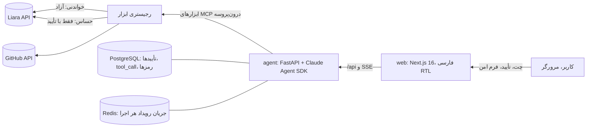

# دیپلویار (Deployar)

همکار فنی فارسی برای برنامه‌نویسی که نرم‌افزارش را ساخته ولی از دیپلوی چیزی نمی‌داند. دیپلویار مخزن
GitHub را می‌خواند، پلن و هزینه‌ی لیارا را پیشنهاد می‌دهد، با تأیید کاربر اپ و دیتابیس می‌سازد، متغیرها را
تنظیم و منتشر می‌کند، و وقتی سایت مشکل پیدا کرد مثل یک SRE شواهد جمع می‌کند، علت‌ها را رتبه‌بندی می‌کند،
با اجازه‌ی کاربر اقدام می‌کند و دوباره اندازه می‌گیرد. چالش لیارا، هکاتون استارکوچ.

| خواسته‌ی بریف | در دیپلویار |
|---|---|
| راه‌اندازی و اولین دیپلوی | `analyze_repo` ← `propose_plan` ← `create_app` / `create_database` / `set_env` ← `deploy_release` ← `watch_deployment` تا لینک زنده |
| دیپلوی و عملیات | انتشار نسخه‌ی جدید، ری‌استارت، تغییر پلن، متغیرها؛ خطای ساخت با علت فارسی و آخر لاگ |
| پایش و نگهداری | صفحه‌ی «پایش»: RAM و CPU، لاگ زنده با جستجو، انتشارها؛ هر ۱۵ ثانیه |
| عیب‌یابی هوشمند | حالت SRE: `http_probe` (قبل) ← لاگ و متریک ← `report_diagnosis` (علت‌ها با احتمال و شواهد) ← اقدام با تأیید ← `verify_after_action` (قبل و بعد) |
| تعامل امن | سه کلاس ریسک در کد، کارت تأیید با هزینه و انقضا، تأیید یک‌بارمصرف امضاشده |
| اعلام محدودیت API | کارت خاکستری «این کار از API برنمی‌آید» و کارت «فقط کار خودت» برای شارژ و DNS |
| دامنه و ایرنیک | `add_domain` رکورد لازم را می‌دهد، کارت قدم‌به‌قدم ایرنیک، دکمه‌ی «الان بررسی کن» (`check_dns`) |

## ۱. معماری کوتاه



- **web** (`web/`): گفتگو با کارت‌ها، چک‌لیست زنده‌ی مراحل، داشبورد، صفحه‌ی پایش و صفحه‌ی اتصال‌ها.
  فونت و آیکون‌ها خودمیزبان‌اند؛ چیزی از بیرون ایران بار نمی‌شود.
- **agent** (`agent/`): هر پیام کاربر یک «اجرا» (run) است با حالت `chat`، `deploy` یا `sre`. حالت از متن
  انتخاب می‌شود (لینک مخزن یا «بالا بیاور» ← دیپلوی؛ «کند شده»، «۵۰۰» ← SRE) و شکل چک‌لیست را ثابت می‌کند.
  مدل از طریق Claude Agent SDK ابزار انتخاب می‌کند؛ ابزارها در `agent/src/deployar/tools/` هستند.
- **دروازه‌ی تأیید سه‌لایه** (قاعده‌ی سخت ۱: در کد، نه فقط در پرامپت):
  1. `can_use_tool` در SDK هر ابزار حساس را تا تصمیم کاربر نگه می‌دارد و کارت تأیید می‌فرستد.
  2. خود رجیستری پیش از اجرا دوباره چک می‌کند که تأییدِ تأییدشده‌ی مصرف‌نشده با همین ورودی‌ها (هش) هست.
  3. تریگر `tool_call_gate` در PostgreSQL اجرای ابزار حساس بدون تأیید معتبر را رد می‌کند.
  تأیید با HMAC امضا می‌شود، ۱۰ دقیقه اعتبار دارد و فقط یک فراخوانی را آزاد می‌کند.
- **رمزها**: توکن لیارا و GitHub فقط در صفحه‌ی اتصال‌ها گرفته و با AES-256-GCM ذخیره می‌شوند و هرگز به مدل یا
  لاگ نمی‌رسند. `DATABASE_URL` سمت سرور ساخته، رمزنگاری و فقط با شناسه (`value_ref`) به `set_env` داده می‌شود؛
  تستی با رمز «قناری» چک می‌کند که در هیچ خروجی ابزار، ردیف `tool_call` یا کارت تأیید نیاید.
- **هر عدد منبع و زمان دارد** (`liara:/v1/billing · ۱۹:۳۴`) و هر اقدام با اندازه‌گیری دوباره بسته می‌شود.

## ۲. اتصال به APIهای لیارا

پایه `https://api.liara.ir` با هدر `Authorization: Bearer <token>`؛ برای حساب تیمی `teamID` به همه‌ی
درخواست‌ها اضافه می‌شود. کلاینت در `agent/src/deployar/clients/liara.py` است: محدودیت ۵ درخواست در ثانیه،
تکرار فقط برای GET (نوشتن روی 5xx تکرار نمی‌شود تا چیزی دوبار ساخته نشود)، و حذف مقدارهای حساس (مقدار env،
`root_password`) از پاسخ‌ها پیش از رسیدن به هر لایه‌ی دیگر. شکل‌ها با `developers.liara.ir/spec/paas.yaml` و
`dbaas.yaml` و CLI منبع‌باز لیارا تطبیق داده شده‌اند (`skills/liara-api/SKILL.md`).

| ابزار | ریسک | Endpoint |
|---|---|---|
| `get_balance` | خودکار | `GET /v1/billing` (اعتبار تیم از `team`) |
| `list_plans`، `propose_plan` | خودکار | `GET /v1/me` (`plans`، قیمت ساعتی به تومان) |
| `get_app_status`، `get_env_keys` | خودکار | `GET /v1/projects/{name}` (فقط نام کلیدها) |
| `get_logs` | خودکار | `GET /v1/projects/{name}/logs?since=` |
| `get_metrics` | خودکار | `GET /v1/projects/{name}/metrics/{summary,cpu,memory}` |
| `list_releases` | خودکار | `GET /v1/projects/{name}/releases` |
| `watch_deployment` | خودکار | `GET /v1/releases/{id}`، `GET /v2/releases/{id}/build-logs` |
| `check_dns` | خودکار | `GET /v1/domains/{id}/check` |
| `create_app` | با تأیید | `GET/POST /v1/networks`، `POST /v1/projects` |
| `create_database` | با تأیید | `POST /v1/databases`، `GET /v1/databases/{id}` (`hostname:internalPort`) |
| `set_env` | با تأیید | `POST /v1/projects/update-envs` (ادغام با env فعلی) |
| `deploy_release` | با تأیید | tarball از GitHub ← `POST /v2/projects/{name}/sources` ← `POST /v2/projects/{name}/releases` |
| `restart_app`، `resize_plan` | با تأیید | `POST /v1/projects/{name}/actions/restart`، `POST /v1/projects/{name}/resize` |
| `add_domain` | با تأیید | `POST /v1/domains` |
| `top_up_balance`، `registrar_dns_records` | فقط کاربر | API ندارد؛ کارت قدم‌به‌قدم |

## ۳. محدودیت‌های راهکار

- **شارژ حساب و پنل ایرنیک** از API ممکن نیست؛ دیپلویار قدم‌ها را نشان می‌دهد و بعد دوباره بررسی می‌کند.
  پنل ایرنیک برای دامنه‌ی `.ir` فقط nameserver را عوض می‌کند؛ رکورد CNAME باید در سرویس DNS ثبت شود.
- **لاگ دیتابیس** و کوئری‌های کند دیتابیس از API لیارا در دسترس نیست؛ کوئری کند از لاگ خود اپ پیدا می‌شود.
- **برگرداندن نسخه (rollback)** در API عمومی نیست؛ نسخه‌ی قبلی با `deploy_release` و `ref` قدیمی دوباره منتشر می‌شود.
- **فیکس کد**: دیپلویار علت را تا فایل و خط از لاگ پیدا و تغییر را پیشنهاد می‌دهد، ولی اعمالش با کاربر یا
  Coding Agent خودش است (`apply_code_fix` طراحی شده ولی در این نسخه نیست).
- **پایش در لحظه است، نه ۲۴ ساعته** (بریف لازم نمی‌داند). «قبل» یک اقدام در حافظه‌ی همان اجرا نگه داشته می‌شود.
- **ریختن داده در دیتابیس** (dump بزرگ) و **دیسک دائمی** هنوز ابزار ندارند.
- چند endpoint (شبکه‌ی خصوصی، وضعیت و لاگ ساخت) در مستندات عمومی نیستند و از CLI لیارا برداشته شده‌اند.
- ایجنت روی دستگاه توسعه‌دهنده با ورود Claude Code اجرا می‌شود (درز `LLMClient` برای BoxAPI آماده است).
  نسخه‌ی MVP تک‌کاربره است.

## ۴. نحوه‌ی تعامل کاربر با سیستم

1. **اتصال‌ها**: توکن لیارا (و شناسه‌ی تیم) و توکن GitHub را در صفحه‌ی «اتصال‌ها» می‌چسباند. همان‌جا می‌بیند
   چه ذخیره شده: حساب، چهار حرف آخر توکن، تیم، اعتبار و زمان آخرین بررسی.
2. **خانه**: کارت‌های اعتبار تیم، اپ‌های روی لیارا، GitHub و وضعیت دستیار؛ کنارشان گفتگو و چک‌لیست مراحل.
3. **«ترب‌گرد را روی لیارا بالا بیاور: github.com/…»**: کارت تحلیل مخزن (هر نتیجه با فایل مدرکش)، کارت پلن
   با هزینه‌ی ماهانه و روزهای پوشش اعتبار، بعد برای هر کار هزینه‌دار یک کارت کهربایی با «چه، چرا، چقدر،
   تا کی». کاربر اسلایدر را می‌کشد (یا Enter) یا «نه» می‌زند. مقدارهایی که فقط کاربر دارد در فرم امن وارد
   می‌شوند، نه در چت. ساخت با کارت پیشرفت و آخر لاگ دیده می‌شود و در پایان لینک زنده.
4. **«از صبح سایت کند شده»**: اندازه‌گیری «قبل»، لاگ و متریک، کارت علت‌ها با احتمال و خط لاگ، کارت تأیید
   اقدام (مثلاً RAM از ۵۱۲ به ۱۰۲۴ با هزینه‌ی اضافه)، و کارت «قبل و بعد» با عدد.
5. **پایش**: انتخاب اپ و بازه، نمودار حافظه و پردازنده با راهنمای هر نقطه، لاگ با جستجو، انتشارها.

رنگ‌ها معنی ثابت دارند: سبز = خودکار، کهربایی = فقط و فقط «تأیید تو لازم است»، خاکستری = محدودیت یا کار خودت.

## اجرا

نیازها: Docker، uv، pnpm و Claude Code واردشده (ایجنت روی میزبان از همان ورود استفاده می‌کند).

```bash
make setup   # یک بار: .env، git hooks، وابستگی‌ها
make dev     # web روی :3800، worker، postgres و redis در Docker؛ agent روی :8800
make check   # ruff، mypy، pytest، eslint، tsc، vitest
```

بدون مصرف Claude: `LLM_BACKEND=fake` در `.env` یک دیپلوی و یک عیب‌یابی نمایشی کامل را با همان دروازه‌ی تأیید
و همان کارت‌ها اجرا می‌کند. آزمایشگاه خطا در `lab/` است: یک اپ کوچک که `FAULT=memory|error|slow` آن را عمداً
خراب می‌کند تا حلقه‌ی SRE روی حساب واقعی لیارا نشان داده شود.

### اجرا روی سرور (لیارا)

`Dockerfile` ریشه وب (Next.js) و ایجنت را در یک کانتینر می‌گذارد: ایجنت فقط روی loopback گوش می‌دهد و `/api`
از طریق Next.js به آن می‌رسد، پس یک اپ لیارا کافی است و ایجنت هیچ‌وقت عمومی نیست. روی سرور ورود Claude Code
نیست، پس `LLM_BACKEND=boxapi` است: همان حلقه‌ی ابزارها با `anthropic/claude-haiku-5.5` از BoxAPI، و هر ابزار
همچنان از همان دروازه‌ی تأیید و تریگر دیتابیس رد می‌شود. وقتی اعتبار `BOXAPI_API_KEY` تمام شود،
`BOXAPI_KEY_SECOND` خودکار جایش را می‌گیرد.

envهای لازم: `DATABASE_URL` و `REDIS_URL` (از دیتابیس‌های لیارا؛ آدرس `postgresql://` خودکار به asyncpg تبدیل
می‌شود)، `DEPLOYAR_TOKEN_KEYS`، `APPROVAL_SECRET`، `DEPLOYAR_PASSPHRASE`، `DEPLOYAR_EMAIL` (کاربر یکتا، هنگام
شروع ساخته می‌شود)، `BOXAPI_API_KEY` و `BOXAPI_KEY_SECOND`. مهاجرت‌ها هنگام شروع کانتینر اجرا می‌شوند.

اسناد طراحی: `docs/SYSTEM-DESIGN.md`، `docs/ARCHITECTURE.md`، `docs/DATA-MODEL.md`، `docs/decisions.md`.
