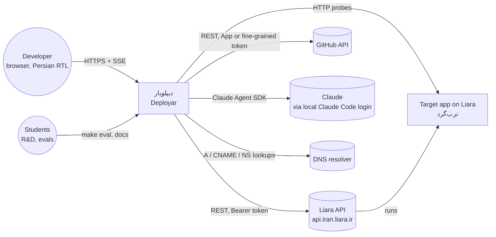
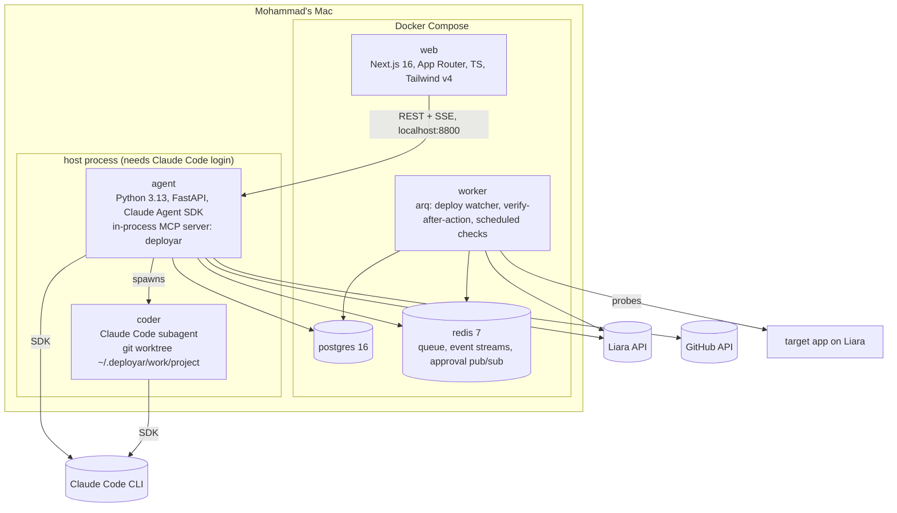
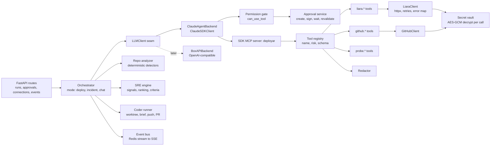
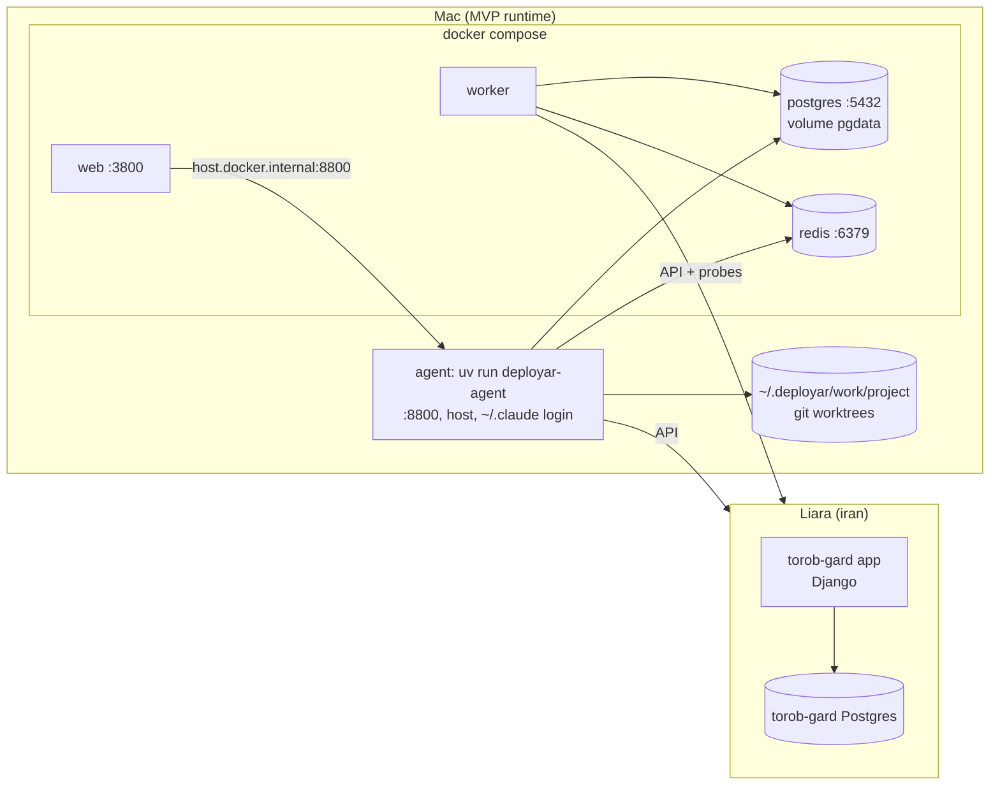
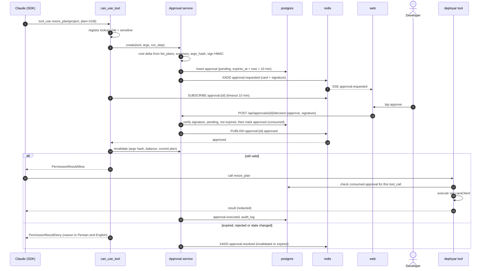
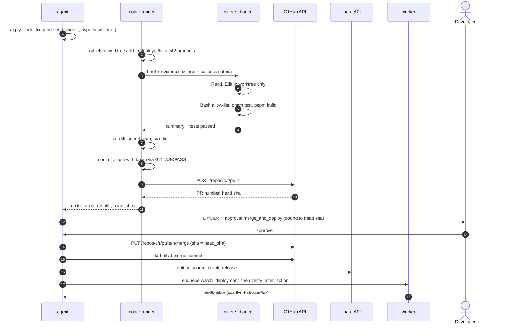
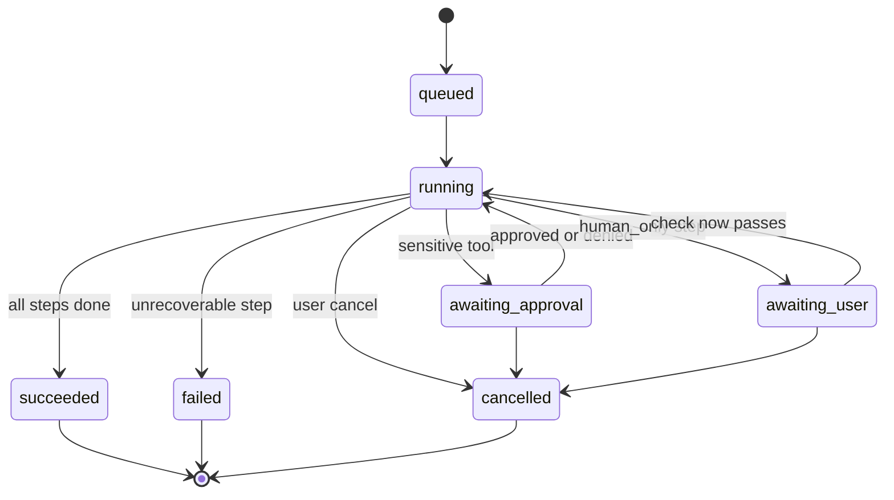
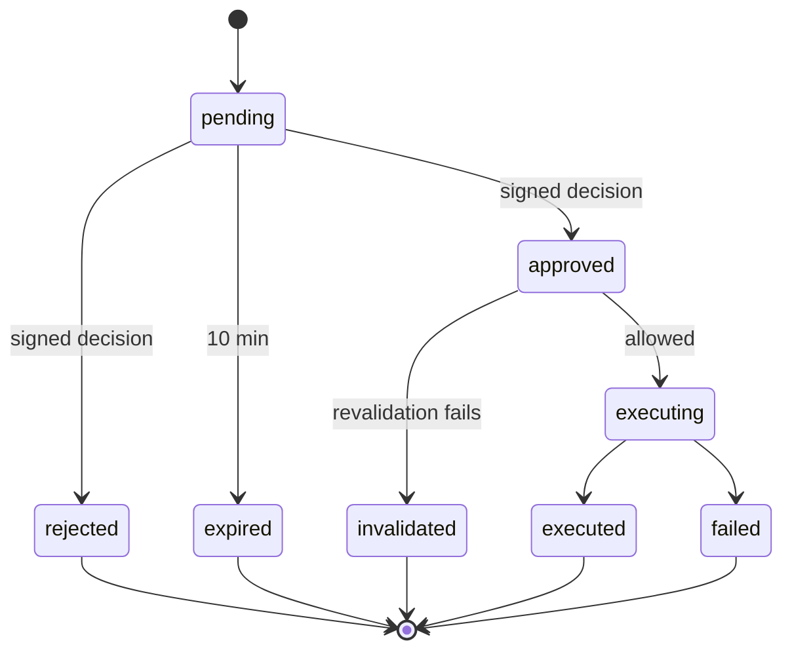
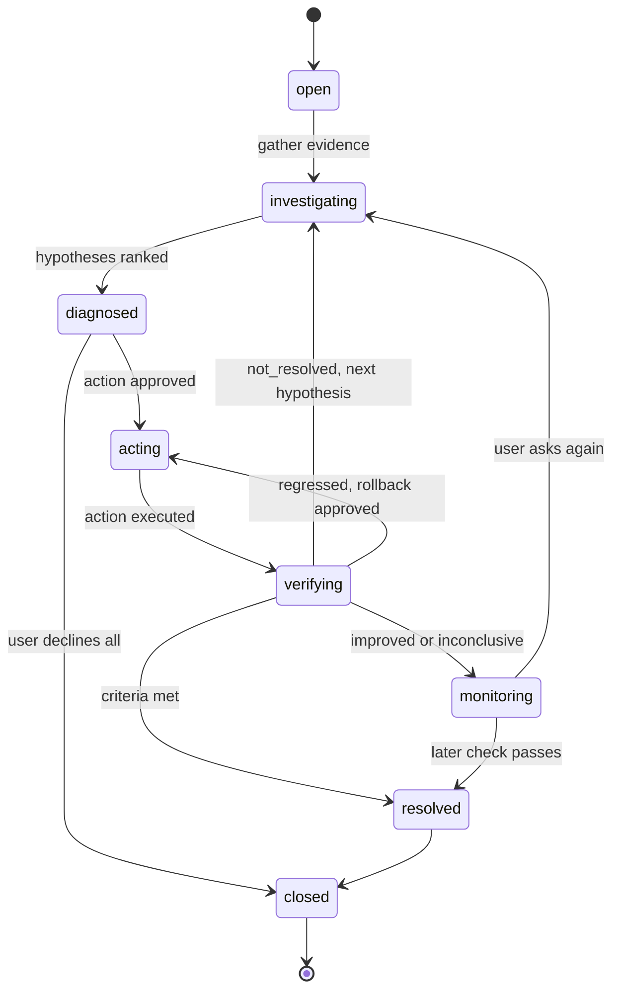
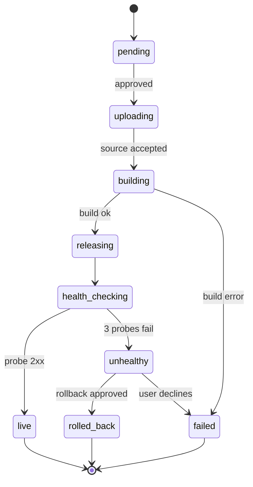

# Software architecture

C4 style: context → containers → components → deployment, then sequences, state machines, API
contract, tool registry, repo layout, conventions, testing and ADRs. Read with `SYSTEM-DESIGN.md`
(what and why) and `DATA-MODEL.md` (tables). Diagrams are mermaid; the published page renders them.

## 1. Context



Deployar is a single-user tool in the MVP: it runs on Mohammad's Mac and drives his Liara account. The
target app runs on Liara. Nothing outside this diagram is called at runtime.

## 2. Containers



| Container | Owns | Does not |
|---|---|---|
| **web** | Chat, cards, live checklist, status side panel, approval UI, SSE client, Jalali/Persian digits | No business logic, no DB, never sees tokens |
| **agent** | Runs, orchestration, the `deployar` MCP tool server, approval gate (`can_use_tool`), Liara/GitHub clients, repo analysis, SRE ranking, SSE endpoint, migrations (Alembic) | No long polling loops (delegated to worker) |
| **worker** | Deployment watcher, `verify_after_action`, scheduled checks, DNS re-checks | **No LLM calls**: deterministic, so it can run in a container without the Claude login |
| **coder** | Editing code in a worktree and running the repo's tests | No git push, no network credentials, no access outside the worktree |
| **postgres** | Source of truth: runs, steps, approvals, incidents, audit | |
| **redis** | arq queue; per-run event stream (`run:{id}:events`, XADD/XREAD) for SSE replay; approval channel `approval:{id}` | Not a source of truth; losing it never loses an approval |

## 3. Components — agent



- **Orchestrator**: creates the `run`, fixes the step template for the mode, opens a `ClaudeSDKClient`
  with the mode prompt, streams model text as `message.delta`, maps tool calls to `run_step` rows and
  checklist events. Model output for cards is structured (pydantic-validated JSON blocks); the UI draws
  cards, the model never writes layout.
- **SDK options (main agent)**: `mcp_servers={"deployar": sdk_server}`, `allowed_tools` = **read tools by name only**
  (a wildcard or any sensitive tool there skips `can_use_tool`; B-00 finding), `tools=[]` plus built-ins
  disallowed (Bash, Read, Write, Edit, WebFetch, WebSearch), `strict_mcp_config=True`, `setting_sources=[]`
  (no user CLAUDE.md), `can_use_tool=gate`, `max_turns` per mode (deploy 40, incident 30).
- **Tool registry**: every tool is a typed async function with `@deployar_tool(name, group, risk)`. The
  decorator registers it with the SDK MCP server, records `tool_call` rows, runs the redactor on output,
  converts known API gaps into `Limitation` results, and for `sensitive` tools re-checks the approval.
- **Vault**: decrypts the token for one call, passes it to the client, drops it. Tokens are never
  arguments of any tool and never part of a tool result.
- **SRE engine**: turns evidence into signals (`sre/signals.py`), scores hypotheses (`sre/ranking.py`),
  and attaches success criteria to each proposed action (`sre/criteria.py`). The model explains and may
  re-order with a stated reason; scores and criteria stay deterministic.

## 4. Components — web

```
src/app/
  page.tsx                         project list + "new project" (GitHub link)
  p/[projectId]/page.tsx           conversation + live checklist + status side panel
  p/[projectId]/incidents/[id]/    incident timeline / post-mortem
  settings/connections/            Liara token, GitHub
src/components/
  chat/        Composer, MessageList, Stream
  checklist/   RunChecklist, StepRow (state icon, duration, source)
  cards/       RepoAnalysisCard, PlanCard, ApprovalCard, EvidenceCard, HypothesesCard,
               DiffCard, VerificationCard, LiveUrlCard, DomainGuide, HumanOnlyCard, LimitationBox
  status/      StatusPanel (app state, plan, RAM/CPU sparkline, last release, balance; each with source + time)
src/lib/       api.ts (typed from agent OpenAPI), sse.ts (reconnect + Last-Event-ID), persian.ts (digits, Jalali), money.ts (toman)
```

Colour semantics follow the brand: amber only for approval/sensitive, mint for healthy/automatic,
violet for metrics/info, red for errors, grey for limitations.

## 5. Deployment



`make dev` starts Compose and the agent on the host. `make check` runs lint, types and tests. The
agent can also run in Compose (`AGENT_IN_DOCKER=1`) once the BoxAPI backend exists; until then it must
see the host's Claude Code login. Backups: `pg_dump` on `make backup` (local tool, no prod data
besides the audit trail).

## 6. Key sequences

### 6.1 Approval gate



If Redis drops the publish, the gate's timeout path re-reads the row from Postgres before denying.

### 6.2 Code fix via Claude Code



The subagent has no credentials and never pushes. Its `can_use_tool` rejects any path outside the
worktree and any Bash command not on the allow-list.

## 7. State machines

### Run



### Approval



### Incident



### Deployment



## 8. API contract (web ↔ agent)

JSON over HTTPS on `localhost:8800`, prefix `/api`. Errors: `{"error":{"code":"liara_unauthorized","message_fa":"…","detail":"…"}}`.
Ids are UUIDv7 strings; times RFC 3339 UTC; money integer toman.

| Method | Path | Body → Response |
|---|---|---|
| POST | `/api/session` | `{passphrase}` → sets httpOnly cookie |
| POST | `/api/connections/liara` | `{token}` → `{id, token_last4, account, verified_at}` (token validated with `get_balance`) |
| POST | `/api/connections/github` | `{installation_id}` or `{token}` → `{id, login, scopes}` |
| GET / POST | `/api/projects` | `{name, repo_url}` → `project` |
| GET | `/api/projects/{id}/status` | side-panel snapshot; each value `{value, source, observed_at}` |
| POST | `/api/runs` | `{project_id, conversation_id?, text, mode?}` → `{run_id, conversation_id}` |
| GET | `/api/runs/{id}` | run + steps (polling fallback) |
| POST | `/api/runs/{id}/cancel` | → `{status}` |
| GET | `/api/runs/{id}/events` | **SSE**; resumes with `Last-Event-ID` |
| POST | `/api/approvals/{id}/decision` | `{decision:"approve"\|"reject", signature, note?}` → `{status}` |
| POST | `/api/probes/{kind}` | kind `dns`, `balance`, `health` → `{ok, observed, expected, observed_at}` |
| GET | `/api/incidents/{id}` | incident + evidence + hypotheses + actions + verifications |
| GET / PATCH | `/api/projects/{id}/checks` | scheduled checks list / enable, interval |

### SSE events

Envelope (every event): `id` = stream sequence, `event` = type, `data`:

```json
{ "run_id": "0192…", "seq": 17, "ts": "2026-10-22T09:14:02Z", "type": "step.done", "data": { } }
```

| Type | `data` |
|---|---|
| `run.started` | `{"mode":"incident","steps":[{"key":"evidence","title_fa":"جمع‌آوری شواهد"}]}` |
| `run.status` | `{"status":"awaiting_approval"}` |
| `step.started` / `step.done` / `step.failed` | `{"step_id":"…","key":"deploy","title_fa":"…","duration_ms":4200,"error":{"code":"…","message_fa":"…"}}` |
| `step.progress` | `{"step_id":"…","text":"npm run build · 42s","log_tail":["…"]}` (redacted) |
| `message.delta` / `message.done` | `{"message_id":"…","text":"…"}` |
| `tool.called` / `tool.result` | `{"tool_call_id":"…","name":"get_metrics","risk":"read","status":"ok\|limitation\|error"}` |
| `card` | `{"card_type":"plan_proposal","payload":{…}}` (shapes below) |
| `approval.requested` | `{"approval_id":"…","tool":"resize_plan","summary_fa":"…","why_fa":"…","cost_delta_toman":120000,"cost_source":{"source":"liara.plans","observed_at":"…"},"changes":{"plan":{"from":"small","to":"1gb"}},"diff_url":null,"expires_at":"…","signature":"…"}` |
| `approval.resolved` | `{"approval_id":"…","status":"approved\|rejected\|expired\|invalidated","reason_fa":"…"}` |
| `status.snapshot` | same shape as `GET /status` |
| `run.done` | `{"status":"succeeded","summary_fa":"…"}` |

Card payloads (selection):

```json
{"card_type":"hypotheses","payload":{"items":[
  {"id":"h1","title_fa":"کمبود RAM","confidence":"high","score":0.82,"evidence_ids":["e1","e2"],"actions":["a1"]},
  {"id":"h2","title_fa":"کوئری کند در /products","confidence":"medium","score":0.55,"evidence_ids":["e3","e4"],"actions":["a2"]}]}}
{"card_type":"verification","payload":{"verdict":"resolved","metrics":[
  {"key":"p95_products_ms","before":4200,"after":320,"source":"probe","before_at":"…","after_at":"…"},
  {"key":"restarts_1h","before":3,"after":0,"source":"liara.status","before_at":"…","after_at":"…"}]}}
{"card_type":"limitation","payload":{"code":"db_query_log_unavailable","message_fa":"…","workaround_fa":"…"}}
{"card_type":"human_only","payload":{"task":"registrar_dns_records","steps_fa":["…","…","…"],"probe":"dns"}}
```

## 9. Tool registry

Endpoints are **to verify in T-01**. "Limitation case" is what the tool returns when the API can't help.

| Tool | Risk | Endpoint | Inputs | Output | Limitation case |
|---|---|---|---|---|---|
| `github.analyze_repo` | read | `GET /repos/{o}/{r}/git/trees/{ref}`, contents | `project_id, ref?` | platform, runtime, build/start, port, db, env_keys, ram_mb_estimate, evidence files | private repo without access → reconnect card |
| `liara.list_plans` | read | `GET /v1/plans` | `kind: app\|db` | plans `{id, ram_mb, cpu, price_toman_month}` + source/time | static dated table, labelled |
| `liara.get_balance` | read | `GET /v1/me` | — | `balance_toman` + source/time | "balance not readable" |
| `liara.get_app_status` | read | `GET /v1/projects/{name}` | `project_id` | state, plan, restarts_1h, last_release | — |
| `liara.get_logs` | read | `GET /v2/projects/{name}/logs` | `project_id, since, grep?` | redacted lines (max 500) with ts | DB logs → `db_query_log_unavailable` |
| `liara.get_metrics` | read | `GET /v1/projects/{name}/metrics/*` | `project_id, window` | RAM/CPU/net series + plan limits | metrics endpoint absent → limitation |
| `liara.list_releases` | read | `GET /v2/projects/{name}/releases` | `project_id, limit` | releases with status, created_at, source | — |
| `liara.get_env_keys` | read | `GET /v1/projects/{name}` | `project_id` | key names only | — |
| `probe.check_dns` | read | DNS resolver (+ Liara domain check) | `domain` | expected vs observed records | — |
| `probe.http_probe` | read | target app | `project_id, path, n` | status counts, p50/p95 ms | — |
| `liara.create_app` | sensitive | `POST /v1/projects` | `name, platform, plan_id` | app name, url | — |
| `liara.create_database` | sensitive | `POST /v1/databases` | `type, version, plan_id` | db id; connection stored encrypted, never returned | connection not returned → human_only copy step |
| `liara.set_env` | sensitive | `POST /v1/projects/update-envs` | `project_id, keys[], value_refs[]` | keys set (values hidden); restarts app | — |
| `liara.deploy_release` | sensitive | `POST /v2/projects/{name}/sources`, `/releases` | `project_id, git_ref` | release id → deployment watcher | — |
| `liara.restart_app` | sensitive | `POST /v1/projects/{name}/actions/restart` | `project_id` | ok + time | scale 0→1 fallback |
| `liara.resize_plan` | sensitive | `POST /v1/projects/{name}/resize` | `project_id, plan_id` | old/new plan, cost delta | — |
| `liara.rollback_release` | sensitive | `POST /v2/projects/{name}/releases/{id}/rollback` | `project_id, release_id` | release id | redeploy old source |
| `liara.add_domain` | sensitive | `POST /v1/domains` | `project_id, domain` | required DNS records | — |
| `github.apply_code_fix` | sensitive | coder + `POST /repos/{o}/{r}/pulls` | `incident_id, hypothesis_id, brief` | PR url, head sha, diff stats | tests fail → no PR, report |
| `github.merge_and_deploy` | sensitive | `PUT /repos/{o}/{r}/pulls/{n}/merge` + deploy | `code_fix_id, head_sha` | merge sha, release id | head moved → invalidated |
| `liara.top_up_balance` | human_only | — | `amount_toman` | steps + console link + balance probe | always: API cannot pay |
| `probe.registrar_dns_records` | human_only | — | `domain` | 3 registrar steps + DNS probe | always: IRNIC has no API |

`value_refs` for `set_env` point to server-side values (generated secrets, the DB connection string,
user-entered values posted directly to `/api/projects/{id}/env-values`), so secret values never travel
through the model.

## 10. Repo layout

```
agent/
  pyproject.toml  uv.lock  alembic.ini
  src/deployar/
    main.py                 FastAPI app factory
    api/                    runs.py approvals.py connections.py projects.py events.py probes.py
    core/                   config.py db.py crypto.py redact.py logging.py persian.py ids.py
    models/                 SQLAlchemy tables (see DATA-MODEL.md)
    llm/                    client.py (LLMClient protocol) claude_backend.py boxapi_backend.py
    runtime/                orchestrator.py gate.py approvals.py events.py modes/ prompts/
    tools/                  registry.py results.py liara/ github/ probe/
    clients/                liara.py github.py
    analysis/               detectors/ (node, nextjs, python, prisma, docker, env_example)
    sre/                    signals.py ranking.py criteria.py verify.py
    coder/                  worktree.py brief.py runner.py guard.py
    worker/                 settings.py jobs/ (watch_deployment, verify_after_action, scheduled_checks, dns_recheck)
  migrations/
  tests/                    unit/ contract/ cassettes/ live/ evals/
web/
  src/app/ src/components/ src/lib/ e2e/  package.json
evals/incidents/            *.yaml injected-incident cases
skills/                     liara-api/ agent-tools/ brand/
docs/                       SYSTEM-DESIGN.md ARCHITECTURE.md DATA-MODEL.md TASKS.md decisions.md artifacts/
docker-compose.yml  Makefile  .env.example  .githooks/
```

## 11. Code conventions

- **Python**: 3.13, uv, ruff (lint + format), mypy strict on `tools/`, `runtime/`, `core/`; async everywhere (`httpx.AsyncClient`, SQLAlchemy 2 async, asyncpg); pydantic v2 models for every tool input/output and SSE payload.
- **Tools**: one function per tool, `@deployar_tool(name, group, risk)`; returns `Ok[T] | Limitation | ToolError`; never raises for an API gap; never takes or returns a secret.
- **Errors**: stable `code` (snake_case) + `message_fa` for the UI + English `detail` for logs.
- **Persian strings**: in `messages_fa.py` / `web/src/lib/fa.ts`, not inline; digits stored ASCII, rendered Persian; dates stored `timestamptz` UTC, rendered Jalali.
- **Money**: integer toman (`bigint`), formatted only in the UI.
- **Data on screen**: every metric value is `{value, source, observed_at}`; the UI refuses to render a bare number.
- **TypeScript**: strict; server components by default, client components only for chat/SSE; API types generated from the agent's OpenAPI.
- **Ids**: UUIDv7. Migrations additive only.
- **Shortcuts** carry `# shortcut: <limit>, <when to upgrade>`.
- **Commits**: small, imperative; `make check` in the pre-push hook.

## 12. Testing strategy

| Layer | Tool | What |
|---|---|---|
| Unit | pytest | detectors, ranking, criteria, verify verdicts, redactor, crypto, approval signing and expiry, Jalali/digits |
| Gate | pytest (TDD first) | sensitive tool never executes without consumed approval; expired/replayed/tampered signature denied; args change after approval → invalidated; tool-level re-check fires when callback is bypassed |
| Liara client | pytest + recorded responses (`respx` cassettes from the T-01 account, tokens scrubbed) | request shapes, error mapping (401, 404→limitation, 429 retry), pagination |
| Contract | pytest | SSE envelope and card payloads validate against pydantic models; OpenAPI snapshot |
| Secrets | pytest | a canary token never appears in logs, SSE frames, `tool_call` rows or model input transcripts |
| Live smoke | pytest `-m live` on a test Liara account | create tiny app → env → deploy hello-world → logs → restart → delete; run before each demo, not in CI |
| Web | vitest + Playwright | cards render from fixtures; approval flow end to end against a fake agent; RTL at 360 px; reconnect with Last-Event-ID |
| SRE evals | `make eval` | `evals/incidents/*.yaml`: recorded evidence for injected incidents (OOM leak, slow query, bad release 500, missing env, CPU bound, DNS wrong) with expected top hypothesis, expected action class and expected limitation; gate: top-1 ≥ 80%, top-2 = 100%, zero sensitive actions without approval |
| Demo rehearsal | script | the section 14 scenario of SYSTEM-DESIGN on the real account, timed |

## 13. ADRs

| # | Decision | Why | Revisit when |
|---|---|---|---|
| 1 | Python FastAPI agent + Next.js web, no Django | no data-entry workload; one Python service; reuse Torob patterns | admin needs appear |
| 2 | Claude Agent SDK driving local Claude Code (Mohammad's subscription) behind an `LLMClient` seam | no paid API; best tool use; BoxAPI backend later by env var | hosted multi-user version, or subscription limits hurt the demo |
| 3 | Tools as an in-process SDK MCP server `deployar` | no extra process; the same registry can later be served over stdio MCP to the user's own Claude Code | external MCP clients are needed |
| 4 | Approval gate in `can_use_tool` + re-check inside the tool, wait via Redis pub/sub with Postgres as truth | enforced in code, two layers; survives a lost publish | never |
| 5 | Signed one-time decisions, 10 min expiry, re-validation before execution | stale or replayed clicks can't spend money | never |
| 6 | Coder = Claude Code subagent in a git worktree; our code pushes and opens the PR | real multi-file fixes; the subagent holds no credentials | fixes need services (DB) the worktree can't run |
| 7 | Worker is LLM-free and deterministic | runs in a container; verification can't be talked into "resolved" | never |
| 8 | Deterministic detectors and signal scores, LLM explains | repeatable diagnoses, testable evals | eval top-1 plateaus below 80% |
| 9 | `Limitation` is a result type, not an exception | the agent must relay it; the UI shows it; counted for the md doc | never |
| 10 | SSE with a Redis stream per run and `Last-Event-ID` replay | simple, one direction, resumable | two-way live editing |
| 11 | Agent on host, rest in Compose; target app on Liara | the Claude login lives on the host | BoxAPI backend ships |
| 12 | Tokens AES-GCM with key id, resolved server-side per call | never in the LLM, rotatable | multi-tenant → KMS |
| 13 | Own HTTP probe for latency | Liara likely exposes no response-time metric; source labelled `probe` | Liara adds latency metrics |
| 14 | No 24/7 monitoring stack; scheduled checks only | brief says not needed; less to run | paying users |

## 14. Data model summary

Full ERD, columns and indexes: **`DATA-MODEL.md`**. Entities, grouped:

| Group | Entities |
|---|---|
| Identity and connections | `user`, `liara_connection`, `github_connection` |
| Project | `project`, `repo_analysis`, `plan_proposal`, `deployment`, `domain` |
| Conversation and runs | `conversation`, `message`, `run`, `run_step`, `tool_call`, `approval` |
| SRE | `incident`, `evidence`, `hypothesis`, `incident_action`, `verification`, `code_fix` |
| Routine | `scheduled_check`, `check_result` |
| Trust | `limitation_event`, `audit_log` |
| Quality | `eval_case`, `eval_run` |

Key relations: a `user` has one `liara_connection` and one `github_connection`; a `project` has many
`deployment`, `domain`, `incident` and `conversation`; a `conversation` has many `message` and `run`; a
`run` has many `run_step`, each with many `tool_call`; a sensitive `tool_call` has one `approval`; an
`incident` has many `evidence` and `hypothesis`, a `hypothesis` has many `incident_action`, each with
zero or more `verification`; an `incident_action` of kind code has one `code_fix`; `limitation_event`
and `audit_log` reference the `tool_call` that caused them.
