# Data model

Source of truth for the schema of «دیپلویار». PostgreSQL 16 + Redis 7. The `agent/` service
(FastAPI + Claude Agent SDK) and the `arq` worker share one database through SQLAlchemy 2; Alembic
(in `agent/migrations/`) owns every migration. No other service writes to the database.

Conventions:

- **IDs = uuid v7** everywhere, with two exceptions (`audit_log`, `check_result` use
  `bigint generated always as identity`). Why v7: ids appear in URLs, SSE events and signed approval
  tokens, so they must not be guessable or enumerable (rules out bare `bigint` there); v7 is
  time-ordered, so btree inserts stay append-like and `order by id` ≈ `order by created_at`
  (rules out v4); the app can mint the id before insert, which the approval signer needs (it signs
  the approval id before the row commits). The two exceptions are append-only, high-row-count, never
  addressed by URL, and `audit_log` needs a strict total order for its hash chain.
  PG16 has no native `uuidv7()`, so migration `0001` adds `uuid_generate_v7()` (below) as the column
  default; the app uses `uuid_utils.uuid7()`. When we move to PG18, swap the function for `uuidv7()`.
- **Times**: `timestamptz`, stored UTC, rendered Jalali in the UI («۳ آبان ۱۴۰۵، ۱۲:۴۰»).
- **Money**: `bigint` **rial**, suffix `_rial`. The UI divides by 10 and shows toman. Liara prices are
  copied with their source (`"source":"liara:list_plans"`) — never estimated.
- **Persian text** columns end in `_fa`; stored as written.
- **`user` is a reserved word** in PostgreSQL: SQL must write `"user"`. SQLAlchemy quotes it for us.
- **Enums** are PostgreSQL enum types for closed sets (statuses, kinds). Tool names are `text` with a
  check constraint, because the list grows with the tool registry. Adding an enum value is
  `ALTER TYPE … ADD VALUE` in its own Alembic migration (it cannot be used in the same transaction).
- **JSONB** only for payloads whose shape belongs to one feature (analysis, preview, evidence). Every
  JSONB column has a documented shape below and a Pydantic model in `agent/app/schemas/`.
- **Secrets** (Liara token, env var values) live only as AES-GCM ciphertext. They never enter a
  JSONB column, a log line, the LLM context, or an SSE event.

```sql
-- 0001: extensions + uuid v7 (version bits 0111 set on a v4 base; 48-bit unix-ms prefix)
create extension if not exists pgcrypto;
create extension if not exists citext;
create function uuid_generate_v7() returns uuid language sql volatile as $$
  select encode(set_bit(set_bit(overlay(uuid_send(gen_random_uuid())
    placing substring(int8send(floor(extract(epoch from clock_timestamp()) * 1000)::bigint) from 3)
    from 1 for 6), 52, 1), 53, 1), 'hex')::uuid;
$$;
```

## Groups

```
identity & connections        user, liara_connection, github_connection
projects & deploys            project, repo_analysis, plan_proposal, deployment, domain
conversation, runs, approvals conversation, message, run, run_step, tool_call, approval
incidents & SRE               incident, evidence, hypothesis, incident_action, verification, code_fix
checks                        scheduled_check, check_result, limitation_event
audit & evals                 audit_log, eval_case, eval_run
```

26 tables. Auth sessions and magic-link tokens live in Redis, not in Postgres (see Redis keys).

## Overview ERD

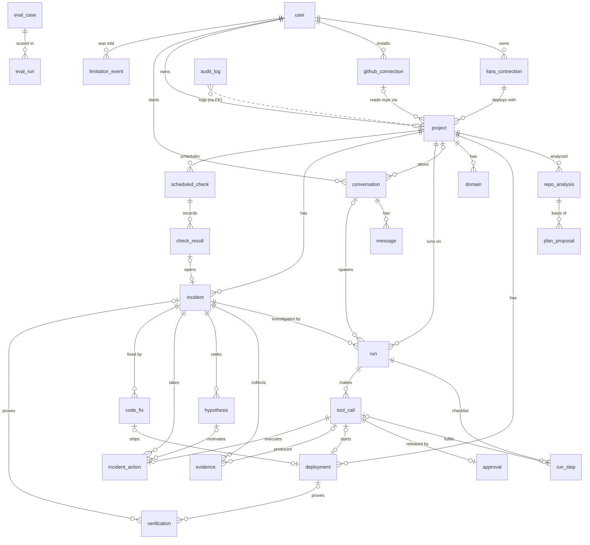

## Identity & connections

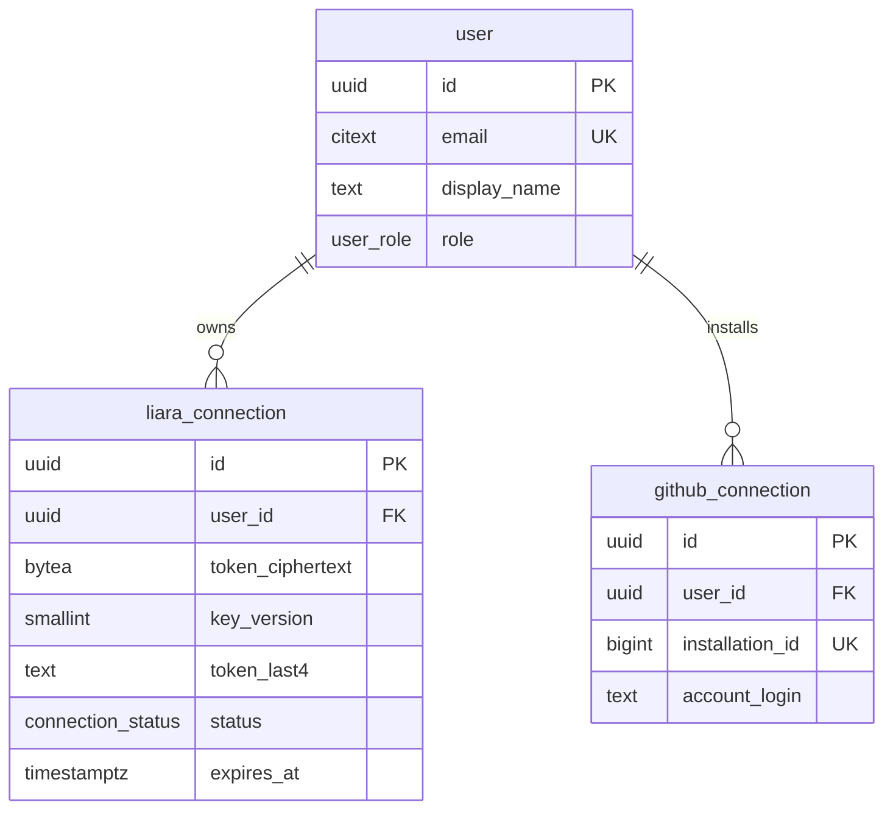

### user — a developer who signs in by email magic link

| column | type | null | default | notes |
|---|---|---|---|---|
| id | uuid | no | `uuid_generate_v7()` | PK |
| email | citext | no | | unique; magic-link login |
| display_name | text | yes | | from the user, shown in the header |
| role | user_role | no | `'member'` | `member`, `admin` (admin sees evals + all audit) |
| locale | text | no | `'fa-IR'` | check `locale in ('fa-IR','en')` |
| created_at | timestamptz | no | `now()` | |
| last_seen_at | timestamptz | yes | | updated at most once per 5 min |
| deleted_at | timestamptz | yes | | soft-delete mark; hard delete runs 30 days later |

- Unique: `email`.
- Account deletion: the hard-delete job deletes the `"user"` row; every owned table cascades.
  `audit_log` has no FK and keeps the rows with `actor_user_id` set to null by that same job.

### liara_connection — an encrypted Liara API token

| column | type | null | default | notes |
|---|---|---|---|---|
| id | uuid | no | `uuid_generate_v7()` | PK; also part of the AES-GCM AAD |
| user_id | uuid | no | | FK `"user"` **on delete cascade** |
| label | text | no | `'Liara'` | user-chosen («حساب اصلی») |
| token_ciphertext | bytea | no | | `nonce(12) ‖ ciphertext ‖ tag(16)`, AES-256-GCM; see Secrets |
| key_version | smallint | no | | which key in `DEPLOYAR_TOKEN_KEYS` encrypted it |
| token_last4 | text | no | | last 4 chars, for display («…9f2c»); check `length(token_last4)=4` |
| liara_account_email | text | yes | | from Liara `/me`, shown to confirm the right account |
| team_id | text | yes | | Liara team, if the token is a team token |
| status | connection_status | no | `'active'` | `active`, `expired`, `revoked`, `invalid` |
| expires_at | timestamptz | yes | | Liara tokens expire 1 h – 1 y; user enters it, or 401 marks `expired` |
| last_verified_at | timestamptz | yes | | last successful `/me` call |
| created_at | timestamptz | no | `now()` | |
| revoked_at | timestamptz | yes | | set with status `revoked`; ciphertext overwritten with `'\x'` |

- Unique partial: `(user_id) where status = 'active'` — one active Liara account per user (MVP).
- Index `(expires_at) where status = 'active'` — nightly "token expires in 7 days" nudge.
- Check: `(status = 'revoked') = (revoked_at is not null)`.
- Column privilege: role `deployar_readonly` has no `select` on `token_ciphertext`.

### github_connection — a fine-grained GitHub token (BUILD.md defaults; GitHub App is P4-optional)

| column | type | null | default | notes |
|---|---|---|---|---|
| id | uuid | no | `uuid_generate_v7()` | PK; also part of the AES-GCM AAD |
| user_id | uuid | no | | FK `"user"` **on delete cascade** |
| token_ciphertext | bytea | no | | same format and keys as `liara_connection` |
| key_version | smallint | no | | |
| token_last4 | text | no | | check `length(token_last4)=4` |
| account_login | text | no | | `amox`, from `GET /user` when the token is saved |
| status | connection_status | no | `'active'` | |
| expires_at | timestamptz | yes | | fine-grained tokens expire; user enters it, or 401 marks `expired` |
| last_verified_at | timestamptz | yes | | |
| created_at | timestamptz | no | `now()` | |
| revoked_at | timestamptz | yes | | check `(status = 'revoked') = (revoked_at is not null)` |

- Unique partial: `(user_id) where status = 'active'`.
- Column privilege: role `deployar_readonly` has no `select` on `token_ciphertext`.
- Needed permissions: contents read/write, pull requests write, metadata read (B-09, B-22).

## Projects & deploys

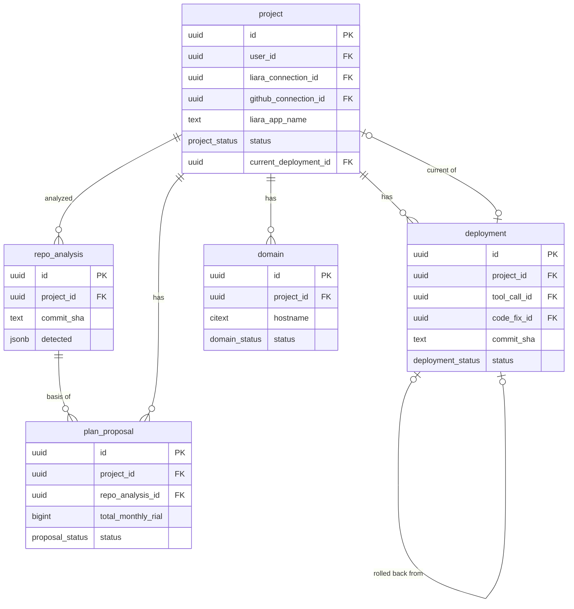

### project — one app on Liara built from one GitHub repo

| column | type | null | default | notes |
|---|---|---|---|---|
| id | uuid | no | `uuid_generate_v7()` | PK |
| user_id | uuid | no | | FK `"user"` on delete cascade |
| liara_connection_id | uuid | no | | FK `liara_connection` **no action** (revoking = status change, never delete; `no action` lets a user-delete cascade finish) |
| github_connection_id | uuid | yes | | FK `github_connection` on delete set null (repo can't be re-read; deploys stay) |
| name | text | no | | display name, «ترب‌گرد» |
| repo_full_name | text | yes | | `amox/torob-gard`; check `~ '^[\w.-]+/[\w.-]+$'` |
| repo_default_branch | text | yes | | `main` |
| liara_app_name | text | yes | | set by `create_app`; check `~ '^[a-z0-9-]{3,32}$'` |
| platform | text | yes | | Liara platform (`next`, `node`, `django`, `docker`, …) validated against the API's list |
| plan_id | text | yes | | current Liara plan id; changed by `resize_plan` |
| liara_db_name | text | yes | | set by `create_database` |
| db_kind | text | yes | | check `in ('postgres','mysql','mariadb','mongodb','redis')` |
| live_url | text | yes | | `https://torob-gard.liara.run` |
| status | project_status | no | `'draft'` | `draft`, `provisioning`, `live`, `degraded`, `down`, `archived` |
| current_deployment_id | uuid | yes | | FK `deployment` on delete set null; added in P1 after `deployment` exists |
| created_at | timestamptz | no | `now()` | |
| updated_at | timestamptz | no | `now()` | trigger `touch_updated_at` |
| archived_at | timestamptz | yes | | |

- Unique partial: `(liara_connection_id, liara_app_name) where liara_app_name is not null` — one row per Liara app.
- Index `(user_id, updated_at desc) where archived_at is null` — project switcher.
- `status` is derived by the agent from the last deployment + open incident + last checks; the
  side panel reads it, it never reads Liara on page load.

### repo_analysis — what the deterministic detectors found in one commit

| column | type | null | default | notes |
|---|---|---|---|---|
| id | uuid | no | `uuid_generate_v7()` | PK |
| project_id | uuid | no | | FK `project` on delete cascade |
| run_id | uuid | yes | | FK `run` on delete set null — the run that called `analyze_repo` |
| commit_sha | text | no | | check `~ '^[0-9a-f]{40}$'` |
| detector_version | text | no | | `detect@3`; bumps invalidate the cache |
| detected | jsonb | no | | shape below |
| summary_fa | text | yes | | LLM's 2–3 sentence explanation of `detected`; never the source of a fact |
| created_at | timestamptz | no | `now()` | |

- Unique: `(project_id, commit_sha, detector_version)` — re-analysis of the same commit is a cache hit.
- Index `(project_id, created_at desc)` — "latest analysis" for the plan card.

`detected` shape (every fact carries the file it came from):

```json
{
  "platform": {"value": "next", "source": "package.json#dependencies.next"},
  "framework": {"name": "next", "version": "16.0.1"},
  "runtime": {"name": "node", "version": "22", "source": ".nvmrc"},
  "package_manager": "pnpm",
  "build_cmd": "pnpm build",
  "start_cmd": "pnpm start",
  "port": {"value": 3000, "source": "package.json#scripts.start"},
  "dockerfile": false,
  "database": {"kind": "postgres", "orm": null, "evidence": ["package.json#dependencies.pg", ".env.example:DATABASE_URL"]},
  "env_vars": [
    {"key": "DATABASE_URL", "required": true, "secret": true, "source": ".env.example:3", "fill": "from_created_db"},
    {"key": "NEXT_PUBLIC_AGENT_URL", "required": true, "secret": false, "source": ".env.example:5", "fill": "ask_user"},
    {"key": "BOXAPI_KEY", "required": false, "secret": true, "source": ".env.example:7", "fill": "ask_user"}
  ],
  "ram_estimate_mb": {"value": 512, "basis": "next build + 225k-row catalog page; detector rule ram.next.v2"},
  "warnings": [{"code": "no_healthcheck", "message_fa": "مسیر سلامت (/health) پیدا نشد؛ از صفحهٔ اصلی استفاده می‌کنم."}]
}
```

### plan_proposal — the plan card: Liara plan + DB + price, before any money is spent

| column | type | null | default | notes |
|---|---|---|---|---|
| id | uuid | no | `uuid_generate_v7()` | PK |
| project_id | uuid | no | | FK `project` on delete cascade |
| repo_analysis_id | uuid | no | | FK `repo_analysis` on delete cascade |
| run_id | uuid | yes | | FK `run` on delete set null |
| app_plan_id | text | no | | Liara plan id from `list_plans` |
| app_price_monthly_rial | bigint | no | | check `>= 0` |
| db_plan_id | text | yes | | null when no DB is needed |
| db_price_monthly_rial | bigint | yes | | check `(db_plan_id is null) = (db_price_monthly_rial is null)` |
| total_monthly_rial | bigint | no | | check `= app_price_monthly_rial + coalesce(db_price_monthly_rial,0)` |
| balance_rial | bigint | no | | `get_balance` at proposal time; card warns when < 1 month |
| prices_fetched_at | timestamptz | no | | when `list_plans` was read; stale after 1 h → re-fetch before approval |
| reasoning_fa | text | no | | why this plan (cites `detected.ram_estimate_mb`) |
| alternatives | jsonb | no | `'[]'` | `[{"app_plan_id":"medium","total_monthly_rial":4200000,"why_fa":"…"}]` |
| status | proposal_status | no | `'proposed'` | `proposed`, `accepted`, `rejected`, `superseded` |
| created_at | timestamptz | no | `now()` | |
| decided_at | timestamptz | yes | | |

- Unique partial: `(project_id) where status = 'proposed'` — one open card per project; a new one supersedes.
- Accepting the card is **not** an approval by itself: it queues the `create_app` tool call, whose
  approval preview repeats the price. The plan card and that approval render as one card in the UI.

### deployment — one Liara release

| column | type | null | default | notes |
|---|---|---|---|---|
| id | uuid | no | `uuid_generate_v7()` | PK |
| project_id | uuid | no | | FK `project` on delete cascade |
| run_id | uuid | no | | FK `run` on delete cascade |
| tool_call_id | uuid | yes | | FK `tool_call` on delete set null — the `deploy_release` / `merge_and_deploy` / `rollback_release` call |
| code_fix_id | uuid | yes | | FK `code_fix` on delete set null (P3) |
| rolled_back_from_id | uuid | yes | | FK `deployment` on delete set null — set on a rollback release |
| commit_sha | text | no | | check `~ '^[0-9a-f]{40}$'` |
| source | text | no | `'github_tarball'` | check `in ('github_tarball','liara_rollback')` |
| liara_release_id | text | yes | | from the deploy response |
| status | deployment_status | no | `'queued'` | state machine below |
| build_log_tail | text | yes | | last 200 lines, secrets redacted; nulled after 30 days |
| health | jsonb | yes | | `{"url":"https://…/","status":200,"latency_ms":212,"probed_at":"…"}` |
| error_fa | text | yes | | one Persian sentence when `failed` |
| created_at | timestamptz | no | `now()` | |
| live_at | timestamptz | yes | | check `(status in ('live','superseded','rolled_back')) <= (live_at is not null)` |
| finished_at | timestamptz | yes | | |

- Unique partial: `(project_id) where status in ('queued','uploading','building','releasing','health_check')`
  — at most one deploy in flight per project (the Redis project lock is the fast path; this is the guarantee).
- Index `(project_id, created_at desc)` — release history and "last healthy release" for rollback.

### domain — a custom domain added on Liara

| column | type | null | default | notes |
|---|---|---|---|---|
| id | uuid | no | `uuid_generate_v7()` | PK |
| project_id | uuid | no | | FK `project` on delete cascade |
| hostname | citext | no | | check `~ '^([a-z0-9-]+\.)+[a-z]{2,}$'` |
| liara_domain_id | text | yes | | from `add_domain` |
| status | domain_status | no | `'pending_dns'` | `pending_dns`, `active`, `failed`, `removed` |
| required_records | jsonb | no | | `[{"type":"CNAME","name":"www","value":"torob-gard.liara.run"}]` — shown in the 3-step registrar guide |
| last_check | jsonb | yes | | `check_dns` result: `{"found":[{"type":"CNAME","value":"…"}],"matches":false}` |
| last_checked_at | timestamptz | yes | | |
| verified_at | timestamptz | yes | | |
| created_at | timestamptz | no | `now()` | |

- Unique partial: `(hostname) where status <> 'removed'`.
- Index `(status, last_checked_at) where status = 'pending_dns'` — the worker re-checks pending domains every 10 min for 48 h.

## Conversation, runs & approvals

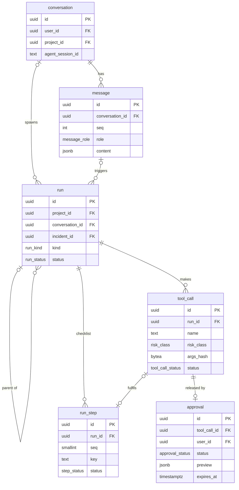

### conversation — one chat thread

| column | type | null | default | notes |
|---|---|---|---|---|
| id | uuid | no | `uuid_generate_v7()` | PK |
| user_id | uuid | no | | FK `"user"` on delete cascade |
| project_id | uuid | yes | | FK `project` on delete set null; null until the repo link creates a project |
| title_fa | text | yes | | first message, trimmed to 60 chars |
| agent_session_id | text | yes | | Claude Agent SDK session id, for `resume` |
| created_at | timestamptz | no | `now()` | |
| last_message_at | timestamptz | no | `now()` | |
| archived_at | timestamptz | yes | | |

- Index `(user_id, last_message_at desc) where archived_at is null` — sidebar.

### message — a chat turn

| column | type | null | default | notes |
|---|---|---|---|---|
| id | uuid | no | `uuid_generate_v7()` | PK |
| conversation_id | uuid | no | | FK `conversation` on delete cascade |
| seq | int | no | | 1, 2, 3 … per conversation |
| role | message_role | no | | `user`, `assistant`, `system`, `tool` |
| content | jsonb | no | | blocks, below |
| model | text | yes | | assistant only, e.g. `claude-opus-5-5` |
| tokens_in | int | yes | | |
| tokens_out | int | yes | | |
| latency_ms | int | yes | | |
| created_at | timestamptz | no | `now()` | |

- Unique: `(conversation_id, seq)` — also the index for paging a thread.
- `content` shape — cards are references, not copies, so a card re-renders from the live row:

```json
[
  {"type": "text", "text_fa": "مخزن را خواندم. یک اپ Next.js با Postgres است."},
  {"type": "card", "card": "plan_proposal", "id": "0192…a1"},
  {"type": "card", "card": "run_checklist", "id": "0192…r1"},
  {"type": "card", "card": "approval", "id": "0192…ap1"},
  {"type": "limitation", "limitation_event_id": "0192…l1"}
]
```

### run — one unit of agent work, shown as a live checklist

| column | type | null | default | notes |
|---|---|---|---|---|
| id | uuid | no | `uuid_generate_v7()` | PK |
| project_id | uuid | yes | | FK `project` on delete cascade; null only for a pure chat run before a project exists |
| conversation_id | uuid | yes | | FK `conversation` on delete set null; null for scheduled runs |
| triggered_by_message_id | uuid | yes | | FK `message` on delete set null |
| parent_run_id | uuid | yes | | FK `run` on delete cascade — a `code_fix` run under an `sre` run |
| incident_id | uuid | yes | | FK `incident` on delete set null (P2) |
| kind | run_kind | no | | `chat`, `deploy`, `sre`, `code_fix`, `check` |
| trigger | run_trigger | no | | `user_message`, `schedule`, `approval_resume`, `retry`, `eval` |
| status | run_status | no | `'queued'` | state machine below |
| arq_job_id | text | yes | | for cancel / inspection |
| error | jsonb | yes | | `{"code":"liara_502","message_fa":"…","tool_call_id":"…"}` |
| created_at | timestamptz | no | `now()` | |
| started_at | timestamptz | yes | | |
| finished_at | timestamptz | yes | | check `finished_at is null or finished_at >= started_at` |

- Index `(project_id, created_at desc)` — project history.
- Index `(project_id) where status in ('queued','running','awaiting_approval')` — "active run" in the side panel.
- Index `(incident_id) where incident_id is not null`.

### run_step — one row of the live checklist

| column | type | null | default | notes |
|---|---|---|---|---|
| id | uuid | no | `uuid_generate_v7()` | PK |
| run_id | uuid | no | | FK `run` on delete cascade |
| seq | smallint | no | | display order |
| key | text | no | | stable step key: `analyze_repo`, `create_app`, `deploy_release`, `verify` … |
| label_fa | text | no | | «ساخت اپ روی لیارا» |
| status | step_status | no | `'pending'` | `pending`, `running`, `blocked` (waiting for approval), `done`, `failed`, `skipped` |
| tool_call_id | uuid | yes | | FK `tool_call` on delete set null; filled when the step executes |
| detail_fa | text | yes | | one line under the row («بیلد ۴۲ ثانیه طول کشید») |
| started_at | timestamptz | yes | | |
| finished_at | timestamptz | yes | | |

- Unique: `(run_id, seq)` — serves `where run_id = ? order by seq`; unique `(run_id, key)`.
- Steps are planned up front (`pending`) so the user sees the whole path before the first action.

### tool_call — every tool the agent calls, read or sensitive

| column | type | null | default | notes |
|---|---|---|---|---|
| id | uuid | no | `uuid_generate_v7()` | PK |
| run_id | uuid | no | | FK `run` on delete cascade |
| message_id | uuid | yes | | FK `message` on delete set null — the assistant turn that asked for it |
| name | text | no | | check against the registry (below) |
| risk_class | risk_class | no | | `read`, `sensitive`, `human_only`; must match `name` (check below) |
| args | jsonb | no | `'{}'` | **redacted** arguments: env var *keys* only, never values |
| args_hash | bytea | no | | sha256 of canonical JSON of the full args (incl. secrets); the approval signs this |
| secret_args_ciphertext | bytea | yes | | AES-GCM of secret args (env values); set to null right after execution or on approval expiry |
| secret_key_version | smallint | yes | | check `(secret_args_ciphertext is null) or (secret_key_version is not null)` |
| idempotency_key | text | no | | `{run_id}:{name}:{hex(args_hash)[:16]}`; replays don't double-create on Liara |
| status | tool_call_status | no | `'proposed'` | `proposed`, `awaiting_approval`, `running`, `succeeded`, `failed`, `rejected`, `expired`, `limitation` |
| result_summary | jsonb | yes | | small: ids, counts, status codes — the LLM sees this, never raw payloads |
| liara_request_id | text | yes | | from the response header, for support tickets |
| http_status | smallint | yes | | |
| duration_ms | int | yes | | |
| error | jsonb | yes | | `{"code":"plan_not_found","message_fa":"…","retryable":false}` |
| created_at | timestamptz | no | `now()` | |
| started_at | timestamptz | yes | | |
| finished_at | timestamptz | yes | | |

- Unique: `idempotency_key`.
- Index `(run_id, created_at)` — tool trace of a run.
- Index `(name, created_at desc)` — per-tool latency/error dashboards in the evals page.
- Checks — the risk table lives in the database too, so a bug in the gate can't misclassify a tool:

```sql
alter table tool_call add constraint tool_call_risk_matches_name check (
  case
    when name in ('analyze_repo','list_plans','get_balance','get_app_status','get_logs','get_metrics',
                  'list_releases','get_env_keys','check_dns','http_probe') then risk_class = 'read'
    when name in ('create_app','create_database','set_env','deploy_release','restart_app','resize_plan',
                  'rollback_release','add_domain','apply_code_fix','merge_and_deploy') then risk_class = 'sensitive'
    when name in ('top_up_balance','registrar_dns_records') then risk_class = 'human_only'
    else false
  end);
-- human_only tools are never executed; they only produce a limitation message
alter table tool_call add constraint tool_call_human_only_never_runs
  check (risk_class <> 'human_only' or status = 'limitation');
-- read tools never wait for approval
alter table tool_call add constraint tool_call_read_no_approval
  check (risk_class <> 'read' or status not in ('awaiting_approval','rejected','expired'));
```

- Trigger — a sensitive call cannot start without a matching approved approval (defence in depth
  behind the Python gate):

```sql
create function tool_call_gate() returns trigger language plpgsql as $$
begin
  if new.risk_class = 'sensitive' and new.status = 'running' and old.status <> 'running' then
    perform 1 from approval a
     where a.tool_call_id = new.id and a.status = 'approved' and a.args_hash = new.args_hash;
    if not found then
      raise exception 'sensitive tool_call % has no approved approval', new.id using errcode = 'P0001';
    end if;
  end if;
  return new;
end $$;
create trigger tool_call_gate before update of status on tool_call
  for each row execute function tool_call_gate();
```

As built in `0003_agent_core` the trigger is stricter than this sketch: it fires on insert and on
any update, treats `running` and `succeeded` as released states (so a row cannot be inserted or
jumped straight to `succeeded`), and rejects an `args_hash` change once released. A sensitive call
may still go `proposed → failed` without an approval, because nothing ran.

### approval — a one-time, signed, 10-minute release for one sensitive tool call

| column | type | null | default | notes |
|---|---|---|---|---|
| id | uuid | no | `uuid_generate_v7()` | PK; minted by the app before insert so it can be signed |
| tool_call_id | uuid | no | | FK `tool_call` on delete cascade; **unique** — one approval per call |
| run_id | uuid | no | | FK `run` on delete cascade (stacking cards of one run) |
| project_id | uuid | no | | FK `project` on delete cascade |
| user_id | uuid | no | | FK `"user"` on delete cascade — who must decide |
| status | approval_status | no | `'pending'` | state machine below |
| preview | jsonb | no | | what / why / cost / diff, shape below; frozen at creation |
| args_hash | bytea | no | | copy of `tool_call.args_hash` at creation; a changed call needs a new approval |
| signature | bytea | no | | HMAC-SHA256(`APPROVAL_SECRET`, `id‖tool_call_id‖args_hash‖user_id‖expires_at`) |
| expires_at | timestamptz | no | `now() + interval '10 minutes'` | check `expires_at <= created_at + interval '10 minutes'` |
| decision | approval_decision | yes | | `approve`, `reject` |
| decided_by | uuid | yes | | FK `"user"` on delete set null; check `decided_by = user_id` when not null (app-checked, FK can't express it — enforced in the decision `update`) |
| decided_at | timestamptz | yes | | check `(decision is null) = (decided_at is null)` and `decided_at <= expires_at` |
| reject_reason_fa | text | yes | | optional free text from the user |
| executed_at | timestamptz | yes | | when the released tool call finished |
| created_at | timestamptz | no | `now()` | |

- Unique: `tool_call_id`.
- Index `(user_id, expires_at) where status = 'pending'` — approvals inbox and badge count.
- Index `(run_id)` — stack all pending cards of a run into one.
- Check: `(status in ('approved','executed','failed')) <= (decision = 'approve')` and
  `(status = 'rejected') = (decision = 'reject')` (with `coalesce` for nulls in the migration).
- One-time use is the conditional `update … where status = 'pending' and expires_at > now()` in the
  key queries; only one request can win it. The signed token on the card is
  `base64url(id).base64url(signature)`; the server recomputes the HMAC (constant-time compare)
  before the update.

`preview` shape (frozen; the card renders only this):

```json
{
  "tool": "resize_plan",
  "title_fa": "ارتقای پلن از small به medium",
  "what_fa": "حافظهٔ اپ از ۵۱۲ به ۱۰۲۴ مگابایت می‌رسد. اپ حدود ۲۰ ثانیه ری‌استارت می‌شود.",
  "why_fa": "در یک ساعت گذشته ۶ بار به‌خاطر کمبود حافظه (OOMKilled) ری‌استارت شده است.",
  "target": {"project": "ترب‌گرد", "liara_app": "torob-gard"},
  "cost": {
    "current_monthly_rial": 1500000, "new_monthly_rial": 3000000, "delta_monthly_rial": 1500000,
    "balance_rial": 17300000, "source": "liara:list_plans", "fetched_at": "2026-10-25T09:13:40Z"
  },
  "diff": {"kind": "plan", "before": {"plan_id": "small", "ram_mb": 512}, "after": {"plan_id": "medium", "ram_mb": 1024}},
  "downtime_fa": "حدود ۲۰ ثانیه",
  "reversible": true,
  "undo_fa": "می‌توانید بعداً با همین دکمه به small برگردید.",
  "hypothesis_id": "0193…h2",
  "evidence_ids": ["0193…e1", "0193…e2"]
}
```

`diff` variants: `{"kind":"env","set":["DATABASE_URL","NEXT_PUBLIC_AGENT_URL"],"masked":{"DATABASE_URL":"…/torobgard?sslmode=require"}}`
(keys + masked tail, never values); `{"kind":"release","from_release":"r-17","to_release":"r-16"}`;
`{"kind":"code","pr_url":"…","files":[{"path":"app/api/products/route.ts","additions":31,"deletions":6}],"patch_ref":"code_fix:0193…cf1"}`
(the diff body is read from `code_fix.diff_patch`, not copied).

## Incidents & SRE

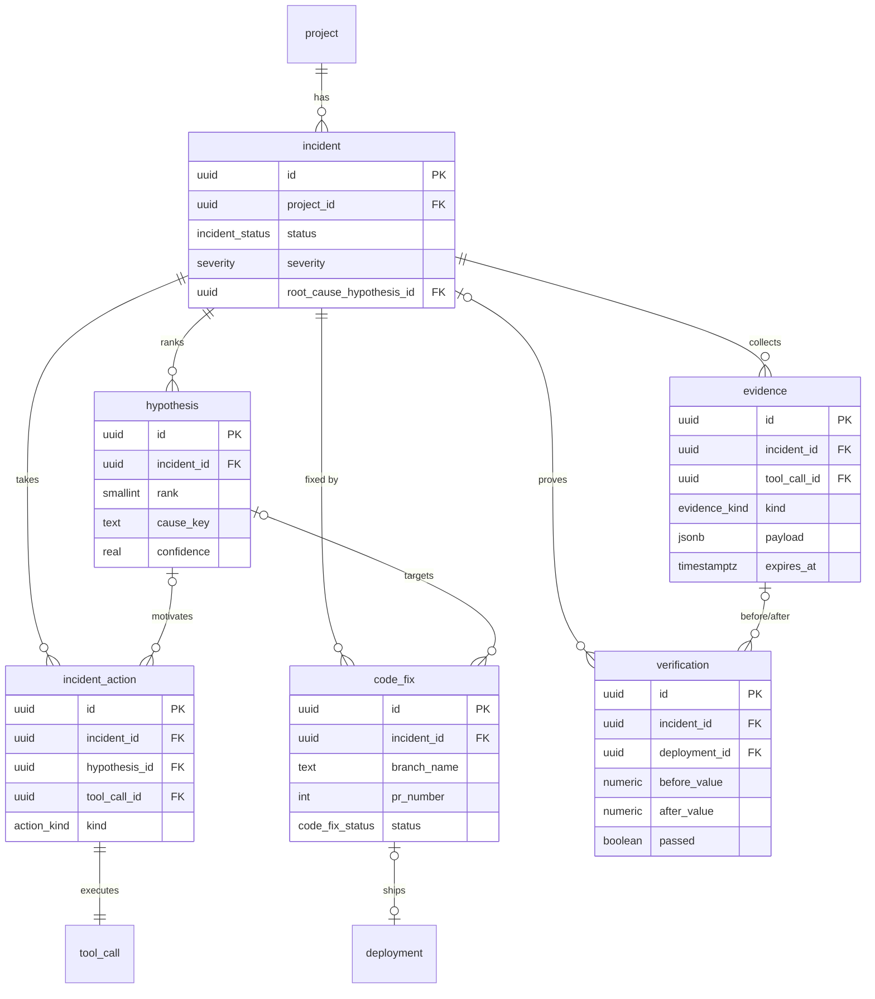

### incident — «سایتم کند شده» or a failed check, from report to proof

| column | type | null | default | notes |
|---|---|---|---|---|
| id | uuid | no | `uuid_generate_v7()` | PK |
| project_id | uuid | no | | FK `project` on delete cascade |
| opened_by_message_id | uuid | yes | | FK `message` on delete set null (user report) |
| check_result_id | bigint | yes | | FK `check_result` on delete set null (P3, scheduled detection) |
| title_fa | text | no | | «کندی و ری‌استارت مکرر» |
| symptom_fa | text | no | | user's words, verbatim |
| severity | severity | no | `'major'` | `info`, `minor`, `major`, `critical` |
| status | incident_status | no | `'open'` | state machine below |
| root_cause_hypothesis_id | uuid | yes | | FK `hypothesis` on delete set null; added after `hypothesis` exists; set on `resolved` |
| opened_at | timestamptz | no | `now()` | |
| mitigated_at | timestamptz | yes | | first successful mitigation |
| resolved_at | timestamptz | yes | | check `(status = 'resolved') <= (resolved_at is not null)` |
| postmortem_md | text | yes | | generated on demand from the timeline |

- Check: `num_nonnulls(opened_by_message_id, check_result_id) >= 1` — every incident says where it came from.
- Index `(project_id, opened_at desc)` — incident list.
- Index `(project_id) where status not in ('resolved','dismissed')` — "open incident" in the side panel.

### evidence — one observation, with its source and time window

| column | type | null | default | notes |
|---|---|---|---|---|
| id | uuid | no | `uuid_generate_v7()` | PK |
| incident_id | uuid | yes | | FK `incident` on delete cascade |
| run_id | uuid | no | | FK `run` on delete cascade |
| tool_call_id | uuid | yes | | FK `tool_call` on delete set null — the read tool that produced it |
| kind | evidence_kind | no | | `status`, `metrics`, `logs`, `releases`, `env_keys`, `http_probe`, `dns`, `note` |
| source | text | no | | `liara:get_metrics`, `probe:deployar-worker` — every number carries this |
| window_start | timestamptz | yes | | check `window_end >= window_start` |
| window_end | timestamptz | yes | | |
| summary_fa | text | no | | one line the user reads; kept forever |
| payload | jsonb | yes | | redacted raw data, ≤ 256 KB (check `pg_column_size(payload) <= 262144`); nulled at `expires_at` |
| payload_bytes | int | yes | | size before truncation, for "truncated" badges |
| captured_at | timestamptz | no | `now()` | |
| expires_at | timestamptz | no | | logs/http_probe +30 d, metrics/status/releases +90 d |

- Index `(incident_id, captured_at)` — timeline.
- Index `(expires_at) where payload is not null` — retention sweep.

`payload` shapes by `kind`:

```json
{"kind":"status","state":"running","restarts_1h":6,"last_restart_reason":"OOMKilled","plan_id":"small","ram_limit_mb":512}

{"kind":"metrics","step_s":60,"series":[
  {"metric":"memory_mb","unit":"MB","limit":512,"points":[["2026-10-25T08:10:00Z",188],["2026-10-25T08:11:00Z",511]]},
  {"metric":"cpu_pct","unit":"%","points":[["2026-10-25T08:10:00Z",14],["2026-10-25T08:11:00Z",97]]}]}

{"kind":"logs","stream":"runtime","truncated":true,"redactions":2,
 "lines":[{"ts":"2026-10-25T08:11:02Z","text":"GET /api/products 200 3911ms"},
          {"ts":"2026-10-25T08:11:09Z","text":"FATAL ERROR: Reached heap limit Allocation failed - JavaScript heap out of memory"}],
 "patterns":[{"signature":"heap out of memory","count":6,"first_ts":"2026-10-25T08:11:09Z","preceded_by":"GET /api/products"}]}

{"kind":"http_probe","url":"https://torob-gard.liara.run/api/products","samples_ms":[3870,4180,4410,3990],
 "p50_ms":4080,"p95_ms":4180,"status_codes":{"200":18,"502":2},"from":"deployar-worker (Tehran)"}

{"kind":"releases","releases":[{"id":"r-1","commit_sha":"9c1e…","created_at":"2026-10-24T06:39:40Z","status":"live"}]}
```

`redactions` counts strings replaced by the redactor (bearer tokens, `postgres://user:pass@`, values of
keys from `get_env_keys` marked secret).

### hypothesis — a ranked possible cause

| column | type | null | default | notes |
|---|---|---|---|---|
| id | uuid | no | `uuid_generate_v7()` | PK |
| incident_id | uuid | no | | FK `incident` on delete cascade |
| rank | smallint | no | | 1 = most likely; check `rank between 1 and 5` |
| cause_key | text | no | | from the cause catalogue: `unbounded_query_memory`, `undersized_plan`, `bad_release`, `db_connection_exhaustion`, `slow_query`, … |
| title_fa | text | no | | «بارگذاری کل جدول محصولات در حافظه» |
| confidence | real | no | | check `confidence between 0 and 1`; ranks of one incident sum ≤ 1.0 (app-checked) |
| rationale_fa | text | no | | cites evidence by id in the UI |
| supporting_evidence_ids | uuid[] | no | `'{}'` | app-validated against `evidence.incident_id` (no FK on arrays) |
| proposed_actions | jsonb | no | `'[]'` | `[{"tool":"resize_plan","kind":"mitigate","args":{"plan_id":"medium"}},{"tool":"apply_code_fix","kind":"fix"}]` |
| status | hypothesis_status | no | `'proposed'` | `proposed`, `testing`, `confirmed`, `refuted`, `dismissed` |
| created_at | timestamptz | no | `now()` | |
| updated_at | timestamptz | no | `now()` | |

- Unique: `(incident_id, rank)` — also serves "hypotheses of an incident in order".

### incident_action — an action taken against an incident (links incident ↔ tool call)

| column | type | null | default | notes |
|---|---|---|---|---|
| id | uuid | no | `uuid_generate_v7()` | PK |
| incident_id | uuid | no | | FK `incident` on delete cascade |
| hypothesis_id | uuid | yes | | FK `hypothesis` on delete set null |
| tool_call_id | uuid | no | | FK `tool_call` on delete cascade; **unique** |
| code_fix_id | uuid | yes | | FK `code_fix` on delete set null (for `apply_code_fix` / `merge_and_deploy`) |
| kind | action_kind | no | | `mitigate`, `fix`, `rollback`, `investigate` |
| outcome | action_outcome | no | `'pending'` | `pending`, `succeeded`, `failed`, `cancelled` (mirrors the tool call once it finishes) |
| created_at | timestamptz | no | `now()` | |

- Unique: `tool_call_id`. Index `(incident_id, created_at)` — timeline.

### verification — before/after proof that an action worked

| column | type | null | default | notes |
|---|---|---|---|---|
| id | uuid | no | `uuid_generate_v7()` | PK |
| run_id | uuid | no | | FK `run` on delete cascade |
| incident_id | uuid | yes | | FK `incident` on delete cascade |
| incident_action_id | uuid | yes | | FK `incident_action` on delete set null |
| deployment_id | uuid | yes | | FK `deployment` on delete cascade (post-deploy verification) |
| code_fix_id | uuid | yes | | FK `code_fix` on delete set null (P3) |
| metric | text | no | | `http_p95_ms`, `restarts_per_hour`, `memory_peak_mb`, `error_rate_pct` |
| method | text | no | | «۲۰ درخواست به /api/products از ورکر، ۳۰ ثانیه پس از استقرار» |
| unit | text | no | | `ms`, `count`, `MB`, `%` |
| before_value | numeric | no | | |
| after_value | numeric | no | | |
| threshold | numeric | no | | pass line, e.g. 800 ms |
| direction | text | no | `'lower_is_better'` | check `in ('lower_is_better','higher_is_better')` |
| passed | boolean | no | | check `passed = case direction when 'lower_is_better' then after_value <= threshold else after_value >= threshold end` |
| before_evidence_id | uuid | yes | | FK `evidence` on delete set null |
| after_evidence_id | uuid | yes | | FK `evidence` on delete set null |
| verified_at | timestamptz | no | `now()` | |

- Check: `num_nonnulls(incident_id, deployment_id) >= 1`.
- Index `(incident_id, verified_at)`, `(deployment_id)`.
- The `passed` check means the database rejects a "success" the numbers don't support.

### code_fix — a Claude Code sub-agent fix: branch → PR → merge → deploy → verify

| column | type | null | default | notes |
|---|---|---|---|---|
| id | uuid | no | `uuid_generate_v7()` | PK |
| project_id | uuid | no | | FK `project` on delete cascade |
| incident_id | uuid | yes | | FK `incident` on delete cascade |
| hypothesis_id | uuid | yes | | FK `hypothesis` on delete set null |
| run_id | uuid | no | | FK `run` on delete cascade — the `code_fix` run of the sub-agent |
| brief_md | text | no | | what the coding agent was asked (cause, files, acceptance test) |
| base_sha | text | no | | check `~ '^[0-9a-f]{40}$'` |
| head_sha | text | yes | | |
| branch_name | text | yes | | `deployar/fix-products-pagination` |
| pr_number | int | yes | | |
| pr_url | text | yes | | |
| diff_stats | jsonb | yes | | `{"files":2,"additions":38,"deletions":6}` |
| diff_patch | text | yes | | unified diff, ≤ 200 KB (check `length(diff_patch) <= 204800`) |
| tests | jsonb | yes | | `{"command":"pnpm test","passed":true,"duration_ms":18400,"output_tail":"…"}` |
| status | code_fix_status | no | `'queued'` | state machine below |
| apply_tool_call_id | uuid | yes | | FK `tool_call` on delete set null — `apply_code_fix` (push branch + open PR) |
| merge_tool_call_id | uuid | yes | | FK `tool_call` on delete set null — `merge_and_deploy` |
| deployment_id | uuid | yes | | FK `deployment` on delete set null |
| created_at | timestamptz | no | `now()` | |
| updated_at | timestamptz | no | `now()` | |

- Unique partial: `(project_id) where status in ('queued','coding','diff_ready','pr_open','merging')` — one open fix per project.
- Index `(incident_id)`.

## Checks

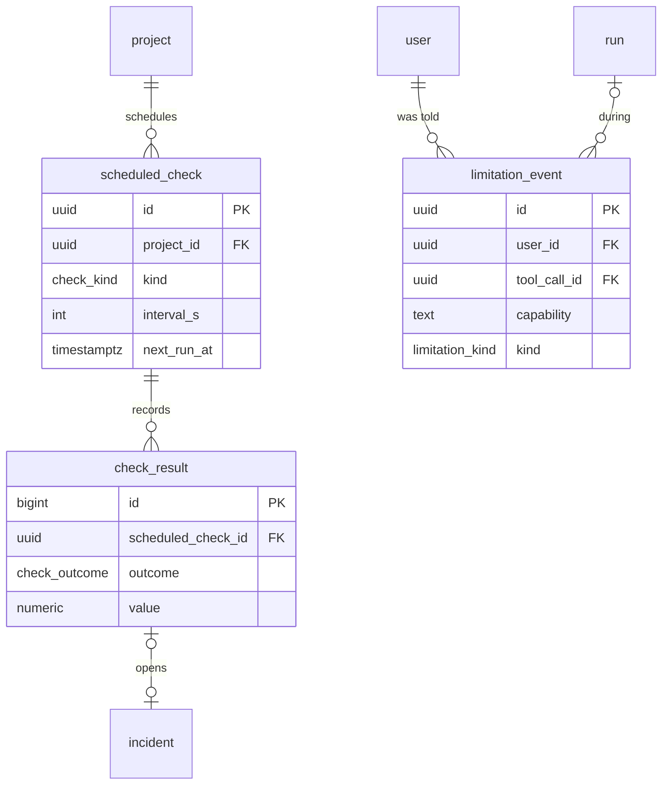

### scheduled_check — a recurring probe the user turned on

| column | type | null | default | notes |
|---|---|---|---|---|
| id | uuid | no | `uuid_generate_v7()` | PK |
| project_id | uuid | no | | FK `project` on delete cascade |
| created_by | uuid | no | | FK `"user"` on delete cascade |
| kind | check_kind | no | | `http_health`, `ram_pressure`, `backup_freshness`, `cert_expiry`, `balance_low` |
| name | text | no | | «سلامت /api/products» |
| interval_s | int | no | `300` | check `interval_s between 60 and 86400` |
| config | jsonb | no | | by kind: `{"url":"…/api/products","expect_status":200,"max_p95_ms":800,"samples":5}`, `{"ram_pct":90,"window":"7d"}`, `{"min_balance_rial":5000000}` |
| enabled | boolean | no | `true` | |
| next_run_at | timestamptz | no | `now()` | |
| last_run_at | timestamptz | yes | | |
| last_outcome | check_outcome | yes | | denormalized for the side panel |
| consecutive_failures | smallint | no | `0` | opens an incident at 3 |
| created_at | timestamptz | no | `now()` | |

- Unique: `(project_id, name)`.
- Index `(next_run_at) where enabled` — the arq cron picks due checks with
  `for update skip locked`.

### check_result — one execution of a check (bigint id: append-only, high volume)

| column | type | null | default | notes |
|---|---|---|---|---|
| id | bigint | no | identity | PK, `generated always as identity` |
| scheduled_check_id | uuid | no | | FK `scheduled_check` on delete cascade |
| started_at | timestamptz | no | `now()` | |
| duration_ms | int | no | | |
| outcome | check_outcome | no | | `ok`, `warn`, `fail`, `error` (error = our probe failed, not the app) |
| value | numeric | yes | | the measured number (p95 ms, RAM %, balance rial) |
| unit | text | yes | | |
| detail | jsonb | no | `'{}'` | `{"status_codes":{"200":5},"samples_ms":[310,298,333,320,305]}` |

- Index `(scheduled_check_id, started_at desc)` — sparkline in the check card.
- Deleted after 30 days except rows referenced by `incident.check_result_id`.

### limitation_event — every time we said «این کار از API لیارا برنمی‌آید»

| column | type | null | default | notes |
|---|---|---|---|---|
| id | uuid | no | `uuid_generate_v7()` | PK |
| user_id | uuid | no | | FK `"user"` on delete cascade |
| project_id | uuid | yes | | FK `project` on delete cascade |
| run_id | uuid | yes | | FK `run` on delete set null |
| tool_call_id | uuid | yes | | FK `tool_call` on delete set null (the `human_only` call, status `limitation`) |
| capability | text | no | | `top_up_balance`, `registrar_dns_records`, `db_slow_query_log`, `log_retention_over_7d` |
| kind | limitation_kind | no | | `human_only` (tool exists, only a human may do it), `api_missing`, `plan_restricted` |
| message_fa | text | no | | the grey box text |
| guide_key | text | yes | | which illustrated guide was shown (`irnic_ns_3_steps`) |
| acknowledged_at | timestamptz | yes | | user tapped «انجام دادم» |
| created_at | timestamptz | no | `now()` | |

- Index `(capability, created_at)` — the "limits" section of the submission doc counts these.

## Audit & evals

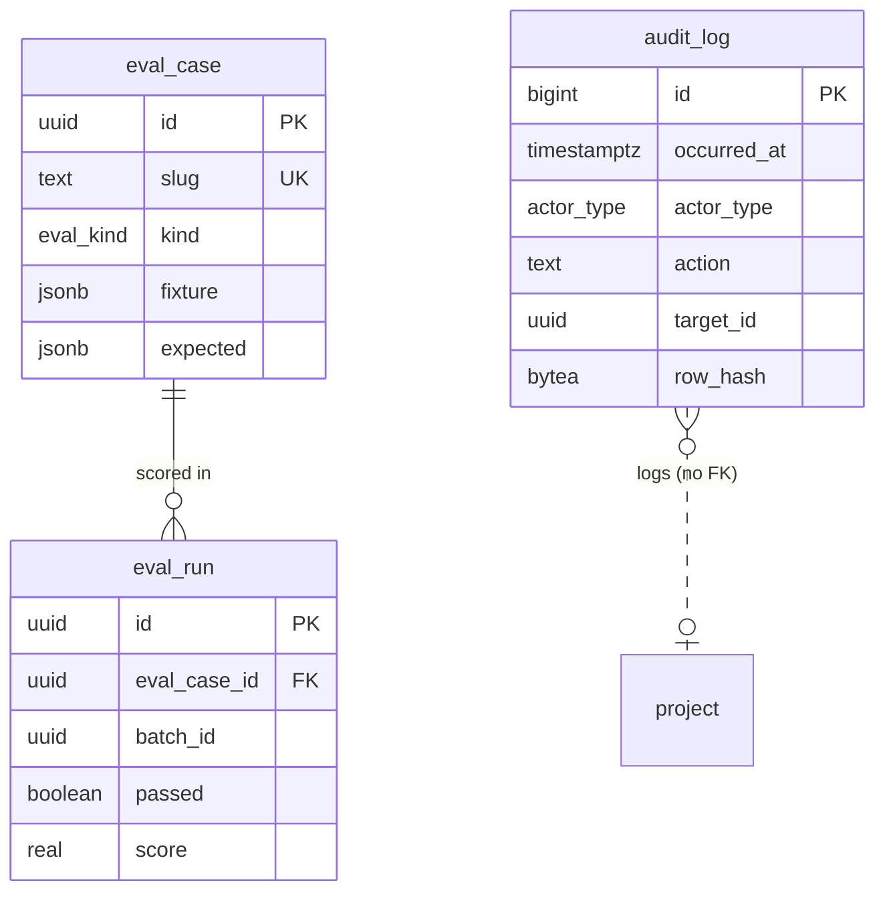

### audit_log — append-only, hash-chained record of everything that changed something

| column | type | null | default | notes |
|---|---|---|---|---|
| id | bigint | no | identity | PK, `generated always as identity`; total order of the chain |
| occurred_at | timestamptz | no | `now()` | |
| actor_type | actor_type | no | | `user`, `agent`, `worker`, `system` |
| actor_user_id | uuid | yes | | no FK (rows survive user deletion; job nulls it) |
| project_id | uuid | yes | | no FK |
| action | text | no | | `connection.created`, `connection.revoked`, `approval.requested`, `approval.decided`, `tool.executed`, `tool.failed`, `incident.resolved`, `auth.login` … check `~ '^[a-z_]+\.[a-z_]+$'` |
| target_type | text | yes | | table name |
| target_id | uuid | yes | | |
| run_id | uuid | yes | | no FK |
| tool_call_id | uuid | yes | | no FK |
| approval_id | uuid | yes | | no FK |
| ip | inet | yes | | user actions only |
| user_agent | text | yes | | |
| data | jsonb | no | `'{}'` | redacted context: `{"tool":"resize_plan","decision":"approve","delta_monthly_rial":1500000}` |
| prev_hash | bytea | no | | `row_hash` of `id - 1` (genesis = 32 zero bytes) |
| row_hash | bytea | no | | sha256(`prev_hash ‖ canonical json of the row without hashes`) |

- No FKs on purpose: the log must outlive what it describes.
- Append-only: `revoke update, delete, truncate on audit_log from deployar_app;` plus a trigger that
  raises on `update`/`delete` for every role except `deployar_migrator`. Inserts go through one SQL
  function `audit_append(...)` that takes `pg_advisory_xact_lock(hashtext('audit_log'))`, reads the
  last `row_hash`, and inserts — so the chain has no forks. `make audit-verify` walks the chain.
- Index `(project_id, occurred_at desc)`, `(target_type, target_id)`, `(approval_id) where approval_id is not null`.
- Written in the **same transaction** as the change it records.

### eval_case — an injected incident or scenario with the expected answer

| column | type | null | default | notes |
|---|---|---|---|---|
| id | uuid | no | `uuid_generate_v7()` | PK |
| slug | text | no | | unique, `oom-unbounded-products-query` |
| title_fa | text | no | | |
| kind | eval_kind | no | | `sre_diagnosis`, `plan_proposal`, `limitation`, `approval_gate` |
| fixture | jsonb | no | | recorded Liara responses keyed by tool + args: `{"get_metrics":{…},"get_logs":{…},"user_turns":["سایتم کند شده"]}` |
| expected | jsonb | no | | `{"top_cause_key":"unbounded_query_memory","top_k_contains":["undersized_plan"],"must_propose_tools":["resize_plan"],"must_not_call":["restart_app"],"must_request_approval":true,"max_delta_monthly_rial":3000000}` |
| tags | text[] | no | `'{}'` | |
| active | boolean | no | `true` | |
| created_by | uuid | yes | | FK `"user"` on delete set null |
| created_at | timestamptz | no | `now()` | |

- Unique: `slug`. Index `gin(tags)`.

### eval_run — one execution of one case (a batch = all cases at one commit)

| column | type | null | default | notes |
|---|---|---|---|---|
| id | uuid | no | `uuid_generate_v7()` | PK |
| batch_id | uuid | no | | groups one `make eval` run |
| eval_case_id | uuid | no | | FK `eval_case` on delete cascade |
| git_sha | text | no | | |
| model | text | no | | |
| prompt_version | text | no | | `sre@4` |
| passed | boolean | no | | |
| score | real | no | | check `score between 0 and 1` |
| actual | jsonb | no | | `{"top_cause_key":"unbounded_query_memory","ranked":[…],"tools_called":["get_app_status","get_metrics","get_logs","http_probe"],"approvals_requested":1}` |
| transcript | jsonb | yes | | full trace; nulled after 90 days except the latest batch |
| judge_notes | text | yes | | |
| duration_ms | int | no | | |
| tokens_in | int | yes | | |
| tokens_out | int | yes | | |
| started_at | timestamptz | no | `now()` | |

- Index `(batch_id)`, `(eval_case_id, started_at desc)` — trend per case.
- Eval runs use `run.trigger = 'eval'` against fixtures; they never call Liara and never create approvals in the real inbox.

## State machines

### approval.status

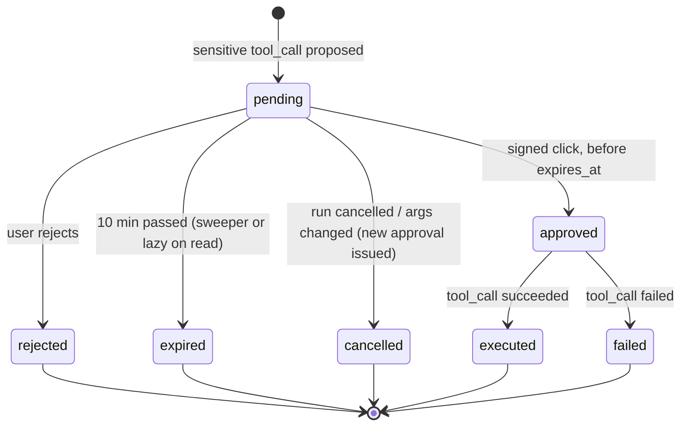

An approval is never reused: a retry after `failed` or `expired` creates a new tool call and a new approval.

### run.status

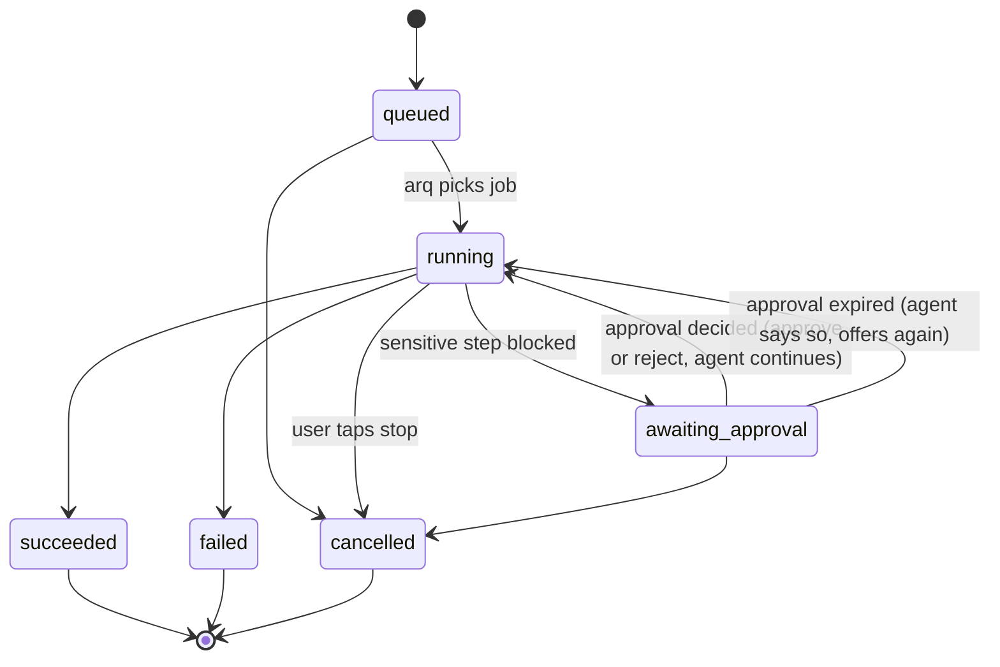

### incident.status

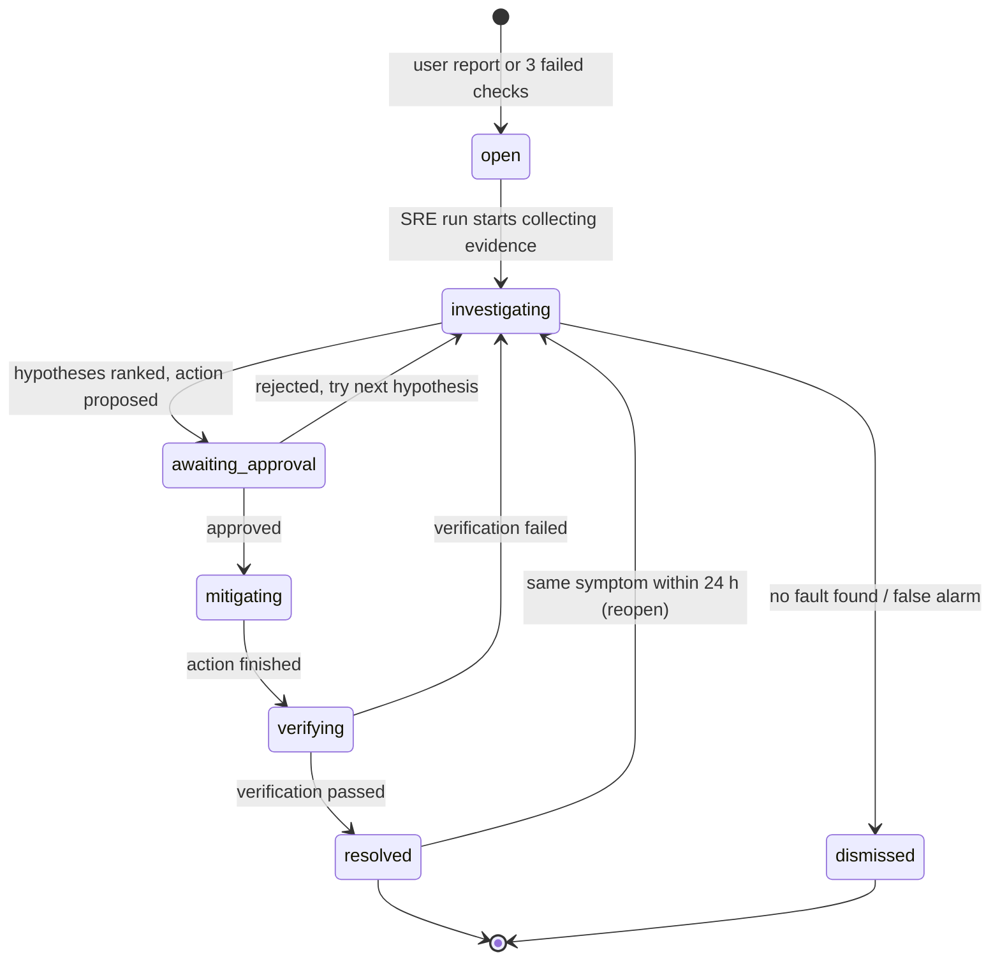

A code fix keeps the incident in `mitigating` until its deployment is live, then `verifying`.

### deployment.status

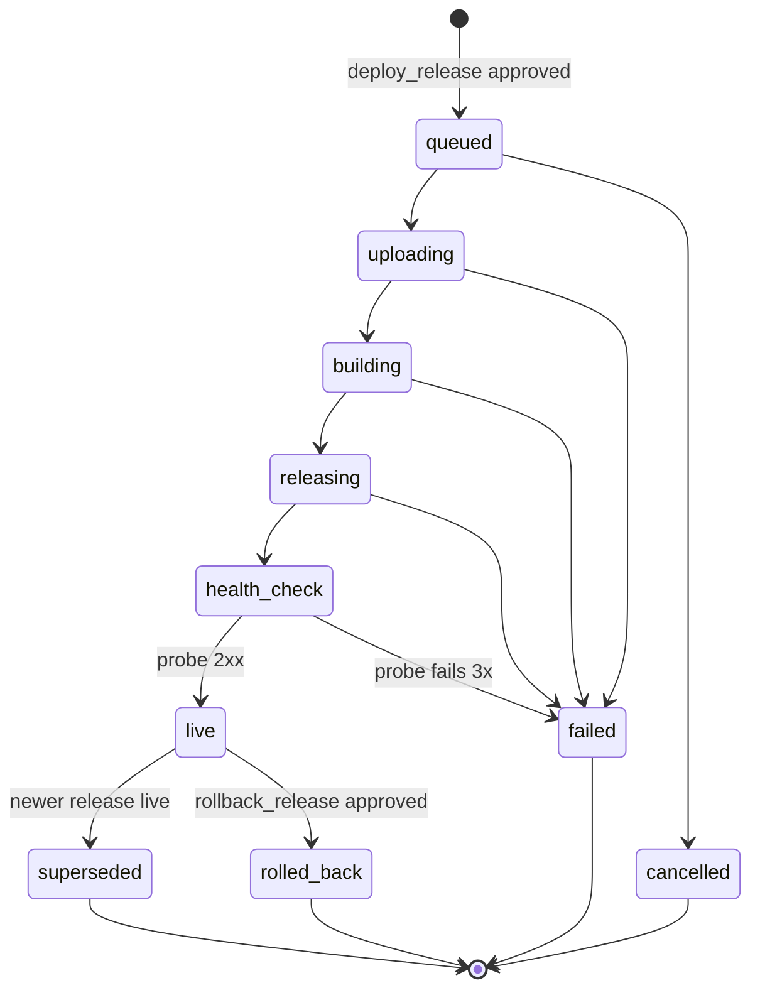

### code_fix.status

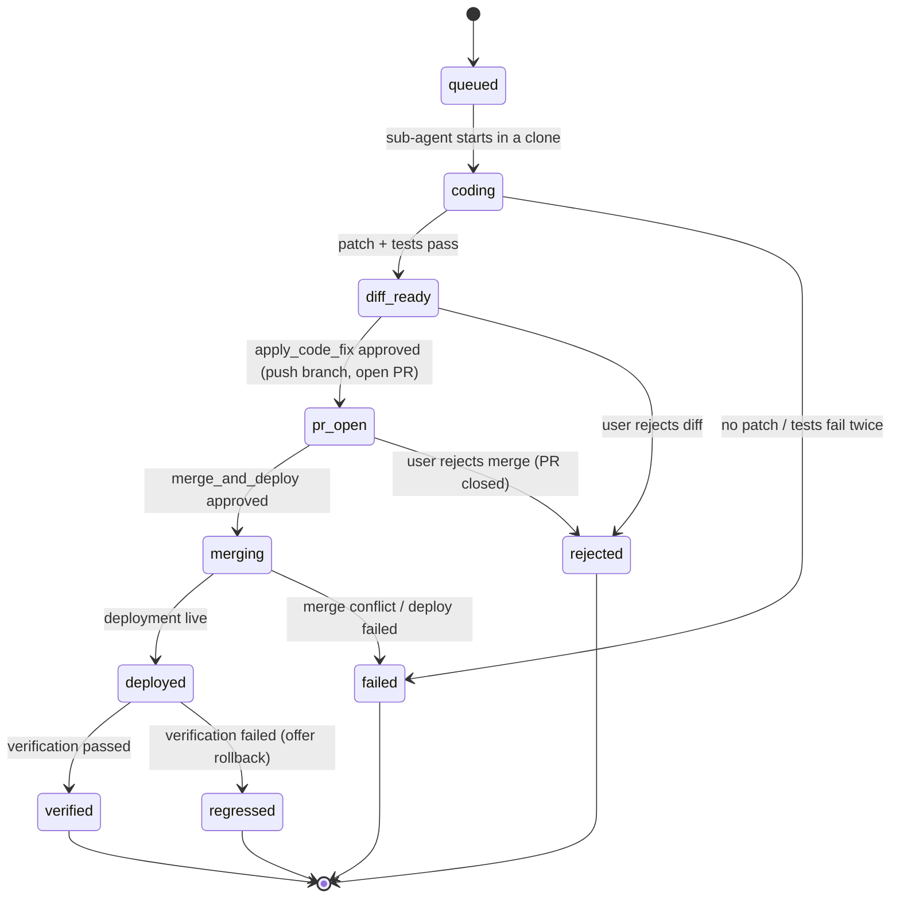

## Data lifecycle & retention

| data | kept | how |
|---|---|---|
| `evidence.payload` (logs, http_probe) | 30 days | nightly `retention_sweep` sets `payload = null`; `summary_fa` stays forever |
| `evidence.payload` (metrics, status, releases) | 90 days | same sweep |
| `deployment.build_log_tail` | 30 days | set to null |
| `check_result` | 30 days | delete, except rows referenced by an incident |
| `tool_call.secret_args_ciphertext` | until executed, max 10 min | nulled on execution, rejection or approval expiry |
| `tool_call`, `approval`, `incident`, `hypothesis`, `verification` | life of the project | small rows; the incident timeline needs them |
| `message` | 180 days after `conversation.last_message_at` | content replaced by `[{"type":"text","text_fa":"(پاک شده)"}]`; cards still resolve |
| `eval_run.transcript` | 90 days, latest batch forever | nulled |
| `audit_log` | forever (min 1 year), append-only | never updated or deleted by the app |
| `limitation_event` | 1 year | delete |
| Redis streams `run:*` | 24 h | `EXPIRE` on create |
| user account | 30 days after `deleted_at` | hard delete cascades; audit rows keep, `actor_user_id` nulled |

The sweep runs as an arq cron at 00:00 UTC (03:30 Tehran) in batches of 5,000 rows with
`for update skip locked`, so it never blocks the live loop.

**Partitioning: not now.** Expected volume per active project per day: ~290 `check_result`, ~60
`tool_call`, ~20 `evidence` (≤ 256 KB each, ~5 MB/day worst case), ~40 `audit_log`. A hundred
projects for a year stays under 15 M rows and ~20 GB, fine for plain btree tables. The two tables
that would need it first, `audit_log` and `evidence`, are time-ordered (identity / uuid v7), so they
can move to native monthly range partitions on `occurred_at` / `captured_at` when either passes
50 M rows or 20 GB — no key change required.

## Secrets handling

**Liara token** (`liara_connection.token_ciphertext`):

1. User pastes the token into a form that posts straight to `POST /connections/liara` (never into chat).
2. Agent calls Liara `/me` with it; on 200, encrypts with **AES-256-GCM**: random 12-byte nonce,
   AAD = `"liara_connection:{id}:{user_id}"` (a ciphertext copied to another row fails to decrypt),
   key = `DEPLOYAR_TOKEN_KEYS[DEPLOYAR_TOKEN_KEY_VERSION]`. Stores `nonce‖ciphertext‖tag`,
   `key_version`, `token_last4`.
3. `DEPLOYAR_TOKEN_KEYS` is an env var, JSON `{"1":"<base64 32 bytes>","2":"…"}`; it is never in the
   database, the repo, or a Docker image layer.
4. Decryption happens only inside `LiaraClient` in the tool executor (agent tool-runner and worker),
   which builds the `Authorization` header itself. Tools receive a `connection_id`, never the token;
   the LLM sees tool *results* only, after the redactor.
5. **Never logged**: the SQLAlchemy type `EncryptedBytes` has `repr = "<encrypted>"`; the structlog
   redaction processor drops keys matching `token|authorization|secret|password|cookie` and scrubs
   any string equal to a decrypted token; httpx request logging is off for the Liara client;
   Postgres runs with `log_parameter_max_length = 0` and `log_statement = 'ddl'`.
6. **Rotation**: add key `"3"`, set `DEPLOYAR_TOKEN_KEY_VERSION=3`, deploy; the arq job
   `rotate_token_keys` re-encrypts rows `where key_version < 3` in batches; when the count is 0, remove
   key `"2"` from env. `key_version` makes the mixed state safe.
7. **Revoke**: status `revoked`, `revoked_at = now()`, `token_ciphertext = '\x'`; audit `connection.revoked`.

**Env var values** (`set_env`) follow the same path in `tool_call.secret_args_ciphertext` and are
wiped after use. `DATABASE_URL` from `create_database` goes worker → ciphertext → `set_env` without
passing through the agent's context. Previews show keys and a masked tail only.

**Approvals**: `APPROVAL_SECRET` (env, 32 bytes) signs approvals; rotating it simply invalidates
pending approvals (max 10 minutes of loss).

**Database roles**: `deployar_migrator` owns the schema (Alembic only); `deployar_app` has DML on all
tables except `update/delete` on `audit_log`; `deployar_readonly` (students, evals, debugging) has
`select` everywhere except `liara_connection.token_ciphertext` and `tool_call.secret_args_ciphertext`.

## Sample rows — one demo story

Ids shortened (`…u1`); real ids are uuid v7. Times UTC; Jalali shown in the UI.
Prices are illustrative until the T-01 capability report confirms Liara's plan list.

**Day 1 — 2026-10-24 (۲ آبان ۱۴۰۵): «این را آنلاین کن»**

`user`

| id | email | display_name | role |
|---|---|---|---|
| …u1 | mohammadsameni1@gmail.com | محمد | admin |

`liara_connection` / `github_connection`

| table | id | user_id | key fields |
|---|---|---|---|
| liara_connection | …lc1 | …u1 | key_version 1, token_last4 `9f2c`, status active, expires_at 2027-04-24 |
| github_connection | …gh1 | …u1 | installation_id 58120931, account_login `amox`, repo_selection selected |

`project`

| id | name | repo_full_name | liara_app_name | platform | plan_id | db_kind | status | current_deployment_id |
|---|---|---|---|---|---|---|---|---|
| …p1 | ترب‌گرد | amox/torob-gard | torob-gard | next | small → medium (day 2) | postgres | live | …d1 → …d2 |

`conversation` …c1 (project …p1). `message` seq 1 user: «این را آنلاین کن https://github.com/amox/torob-gard».
`run` …r1: kind `deploy`, trigger `user_message`, status `succeeded`, 06:32:05 → 06:41:30.

`run_step` of …r1 (the live checklist)

| seq | key | label_fa | status | tool_call |
|---|---|---|---|---|
| 1 | analyze_repo | خواندن مخزن | done | …t1 analyze_repo (read) |
| 2 | propose_plan | پیشنهاد پلن و هزینه | done | …t2 list_plans, …t3 get_balance (read) |
| 3 | create_app | ساخت اپ روی لیارا | done | …t4 create_app (sensitive, approval …a1) |
| 4 | create_database | ساخت دیتابیس Postgres | done | …t5 create_database (…a2) |
| 5 | set_env | تنظیم متغیرهای محیطی | done | …t6 set_env (…a3) |
| 6 | deploy_release | استقرار | done | …t7 deploy_release (…a4) |
| 7 | health_check | بررسی سلامت | done | …t8 http_probe (read) |
| 8 | add_domain | اتصال دامنه | done | …t9 add_domain (…a5), …t10 registrar_dns_records (human_only → limitation …l1) |

`repo_analysis` …ra1: commit `9c1e…`, detector `detect@3`, `detected` = the example shape above (next 16, node 22, pnpm, postgres, 3 env vars, 512 MB).

`plan_proposal` …pp1: app `small` 1,500,000 rial (150,000 toman)/mo, db `postgres-small` 1,200,000 rial/mo, total 2,700,000 rial, balance 20,000,000 rial, status `accepted`.

`approval` (first deploy)

| id | tool_call | status | decision | decided_at | preview.cost.delta_monthly_rial |
|---|---|---|---|---|---|
| …a1 | …t4 create_app | executed | approve | 06:34:51 | 1,500,000 |
| …a2 | …t5 create_database | executed | approve | 06:35:30 | 1,200,000 |
| …a3 | …t6 set_env | executed | approve | 06:36:02 | 0 |
| …a4 | …t7 deploy_release | executed | approve | 06:36:10 | 0 |
| …a5 | …t9 add_domain | executed | approve | 06:42:15 | 0 |

`deployment` …d1: commit `9c1e…`, release `r-1`, status `live` 06:39:40, health `{"status":200,"latency_ms":212}`.
`domain` …dm1: `torobgard.amox.ir`, status `pending_dns` → `active` (day 1, 08:05) after the user set the CNAME.
`limitation_event` …l1: capability `registrar_dns_records`, kind `human_only`, guide `irnic_ns_3_steps`,
message «ثبت رکورد در پنل ثبت‌کنندهٔ دامنه از API لیارا ممکن نیست؛ این سه قدم را خودتان انجام دهید.»

**Day 2 — 2026-10-25 (۳ آبان ۱۴۰۵): «سایتم خیلی کند شده»**

`incident` …i1: project …p1, title «کندی و ری‌استارت مکرر»,
severity `major`, opened 09:10:02, status `open → investigating → awaiting_approval → mitigating →
verifying → mitigating → verifying → resolved` (resolved 10:02:40), root cause …h1.
`run` …r2: kind `sre`, incident …i1. `run` …r3: kind `code_fix`, parent …r2.

`evidence`

| id | kind | source | summary_fa | payload highlight |
|---|---|---|---|---|
| …e1 | status | liara:get_app_status | ۶ ری‌استارت در یک ساعت؛ آخرین علت OOMKilled | `restarts_1h:6, ram_limit_mb:512` |
| …e2 | metrics | liara:get_metrics | حافظه هر بار به سقف ۵۱۲ مگابایت می‌رسد | memory_mb peaks 511/512 |
| …e3 | logs | liara:get_logs | پیش از هر کرش: GET /api/products و heap out of memory | pattern count 6 |
| …e4 | http_probe | probe:deployar-worker | p95 پاسخ /api/products: ۴۱۸۰ میلی‌ثانیه | `p95_ms:4180`, 2× 502 |
| …e5 | releases | liara:list_releases | فقط یک انتشار؛ مشکل از روز اول بوده | 1 release |

`limitation_event` …l2: capability `db_slow_query_log`, kind `api_missing`,
«لاگ کوئری‌های کند دیتابیس از API لیارا در دسترس نیست؛ از لاگ اپ استفاده کردم.»

`hypothesis`

| rank | cause_key | title_fa | confidence | evidence | status |
|---|---|---|---|---|---|
| 1 | unbounded_query_memory | /api/products همهٔ ۲۲۵٬۹۰۳ محصول را یکجا در حافظه می‌خواند | 0.64 | e2, e3, e4 | confirmed |
| 2 | undersized_plan | پلن small (۵۱۲ مگ) برای این اپ کم است | 0.26 | e1, e2 | dismissed (kept as mitigation) |
| 3 | bad_release | انتشار تازه خراب است | 0.10 | e5 | refuted (only one release) |

`approval` …a6 for `tool_call` …t20 `resize_plan` `{"plan_id":"medium"}`: preview = the example above
(delta +1,500,000 rial/mo = 150,000 toman), created 09:14:05, expires 09:24:05, decision `approve`
by …u1 at 09:15:40, status `executed`.
`incident_action` …ia1: kind `mitigate`, hypothesis …h2, tool_call …t20, outcome `succeeded`.

`verification` …v1 (after resize): metric `restarts_per_hour`, before 6, after 0, threshold 0,
`passed = true`. p95 still 1,900 ms in …e6 → the agent says the root cause is in code (h1) and
starts `code_fix` …cf1.

`code_fix` …cf1: branch `deployar/fix-products-pagination`, PR #42, `diff_stats {"files":2,"additions":38,"deletions":6}`
(`app/api/products/route.ts` paginates with `limit 24` + cursor; `app/products/page.tsx` loads pages),
tests `pnpm test` passed. Approvals: …a7 `apply_code_fix` (…t21) approved 09:41:12 → `pr_open`;
…a8 `merge_and_deploy` (…t22) approved 09:52:30 → `merging` → `deployed` (`deployment` …d2,
release `r-2`, commit `4be0…`, `code_fix_id` …cf1, live 09:58:10) → `verified`.
`incident_action` …ia2 (fix, …t21) and …ia3 (fix, …t22).

`verification` …v2

| metric | method | unit | before | after | threshold | passed | before_evidence | after_evidence |
|---|---|---|---|---|---|---|---|---|
| http_p95_ms | ۲۰ درخواست به /api/products از ورکر، ۳۰ ثانیه پس از استقرار | ms | 4180 | 320 | 800 | true | …e4 | …e7 |

Afterwards the user accepts «هر ۵ دقیقه چک کنم؟»: `scheduled_check` …sc1 `http_health`
`{"url":"https://torobgard.amox.ir/api/products","max_p95_ms":800,"samples":5}`; first `check_result`
id 1, outcome `ok`, value 318 ms.

`audit_log` (excerpt)

| id | occurred_at | actor | action | target | data |
|---|---|---|---|---|---|
| 1 | 10-24 06:30:44 | user …u1 | connection.created | liara_connection …lc1 | `{"last4":"9f2c"}` |
| 9 | 10-24 06:34:51 | user …u1 | approval.decided | approval …a1 | `{"tool":"create_app","decision":"approve","delta_monthly_rial":1500000}` |
| 10 | 10-24 06:35:02 | worker | tool.executed | tool_call …t4 | `{"liara_app":"torob-gard","http_status":201}` |
| 41 | 10-25 09:15:40 | user …u1 | approval.decided | approval …a6 | `{"tool":"resize_plan","decision":"approve","delta_monthly_rial":1500000}` |
| 58 | 10-25 10:02:40 | agent | incident.resolved | incident …i1 | `{"root_cause":"unbounded_query_memory","p95_before_ms":4180,"p95_after_ms":320}` |

`eval_case` `oom-unbounded-products-query`: fixture = e1–e5 recorded; expected top cause
`unbounded_query_memory`, must request approval for `resize_plan`, must not call `restart_app` first.

## Migration plan (Alembic)

Rules: one revision per PR, additive first (add column/table → backfill → enforce → drop later),
`ALTER TYPE … ADD VALUE` in a revision of its own, every revision has a working `downgrade`,
CI runs `alembic upgrade head && alembic downgrade base && alembic upgrade head` on an empty PG16.

| phase | revision | tables / changes |
|---|---|---|
| **P0 Foundation** | `0001_base` | extensions, `uuid_generate_v7()`, `touch_updated_at()`, all P0 enum types, roles + grants |
| | `0002_identity` | `user`, `liara_connection`, `github_connection` |
| | `0003_agent_core` | `project` (without `current_deployment_id`), `conversation`, `message`, `run`, `run_step`, `tool_call` (+ risk checks, gate trigger), `approval` |
| | `0004_audit_limits` | `audit_log` (+ append-only trigger, `audit_append()`), `limitation_event` |
| **P1 First deploy** | `0101_deploy` | `repo_analysis`, `plan_proposal`, `deployment`, `domain`; `project.current_deployment_id` FK |
| **P2 SRE loop** | `0201_incidents` | `incident` (without `check_result_id`, `root_cause_hypothesis_id`), `evidence`, `hypothesis`, `incident_action`, `verification` (without `code_fix_id`); `incident.root_cause_hypothesis_id` FK; `run.incident_id` FK |
| | `0202_evals` | `eval_case`, `eval_run` — the SRE eval set is built while tuning diagnosis |
| **P3 Coding fix + checks** | `0301_code_fix` | `code_fix`; `deployment.code_fix_id`, `verification.code_fix_id`, `incident_action.code_fix_id` FKs; enum values for `apply_code_fix`/`merge_and_deploy` already in the tool check since P0 |
| | `0302_checks` | `scheduled_check`, `check_result`; `incident.check_result_id` FK |
| **P4 Ship** | `0401_retention` | retention indexes, `retention_sweep` support; no new tables |
| | `0402_demo_seed` (data, dev/demo only) | eval cases; no user data — demo data comes from really running the story |

The gate (`tool_call` checks + trigger, `approval`) lands in P0 so it is test-driven before any
sensitive tool exists.

## Key queries

**Status side panel** (one round trip; Liara balance comes from Redis cache, not this query):

```sql
select p.id, p.name, p.status, p.live_url, p.liara_app_name, p.plan_id,
       d.status            as deploy_status,  d.commit_sha, d.live_at,
       ar.id               as active_run_id,  ar.kind as active_run_kind, ar.status as active_run_status,
       inc.id              as incident_id,    inc.title_fa as incident_title, inc.status as incident_status,
       coalesce(ap.n, 0)   as pending_approvals,
       chk.checks
from project p
left join deployment d on d.id = p.current_deployment_id
left join lateral (
  select r.id, r.kind, r.status from run r
  where r.project_id = p.id and r.status in ('queued','running','awaiting_approval')
  order by r.created_at desc limit 1) ar on true
left join lateral (
  select i.id, i.title_fa, i.status from incident i
  where i.project_id = p.id and i.status not in ('resolved','dismissed')
  order by i.opened_at desc limit 1) inc on true
left join lateral (
  select count(*) as n from approval a
  where a.project_id = p.id and a.status = 'pending' and a.expires_at > now()) ap on true
left join lateral (
  select jsonb_agg(jsonb_build_object('name', sc.name, 'kind', sc.kind,
                   'outcome', sc.last_outcome, 'at', sc.last_run_at) order by sc.name) as checks
  from scheduled_check sc where sc.project_id = p.id and sc.enabled) chk on true
where p.id = :project_id and p.user_id = :user_id;

-- the live checklist of the active run (then SSE keeps it fresh)
select seq, key, label_fa, status, detail_fa, started_at, finished_at
from run_step where run_id = :active_run_id order by seq;
```

**Incident timeline** (one ordered list for the timeline card and the post-mortem):

```sql
select * from (
  select i.opened_at as at, 'incident.opened' as kind, i.id as ref_id, i.symptom_fa as text, null::jsonb as data
    from incident i where i.id = :incident_id
  union all
  select e.captured_at, 'evidence.' || e.kind, e.id, e.summary_fa,
         jsonb_build_object('source', e.source, 'window', jsonb_build_array(e.window_start, e.window_end))
    from evidence e where e.incident_id = :incident_id
  union all
  select h.created_at, 'hypothesis', h.id, h.title_fa,
         jsonb_build_object('rank', h.rank, 'confidence', h.confidence, 'status', h.status)
    from hypothesis h where h.incident_id = :incident_id
  union all
  select a.created_at, 'approval.requested', a.id, a.preview->>'title_fa',
         jsonb_build_object('tool', a.preview->>'tool', 'delta_monthly_rial', a.preview#>'{cost,delta_monthly_rial}')
    from incident_action ia join approval a on a.tool_call_id = ia.tool_call_id
   where ia.incident_id = :incident_id
  union all
  select a.decided_at, 'approval.' || a.decision, a.id, a.preview->>'title_fa', null
    from incident_action ia join approval a on a.tool_call_id = ia.tool_call_id
   where ia.incident_id = :incident_id and a.decided_at is not null
  union all
  select tc.finished_at, 'action.' || tc.name, ia.id, null,
         jsonb_build_object('kind', ia.kind, 'status', tc.status, 'duration_ms', tc.duration_ms)
    from incident_action ia join tool_call tc on tc.id = ia.tool_call_id
   where ia.incident_id = :incident_id and tc.finished_at is not null
  union all
  select cf.created_at, 'code_fix.' || cf.status, cf.id, cf.branch_name,
         jsonb_build_object('pr_url', cf.pr_url, 'diff_stats', cf.diff_stats)
    from code_fix cf where cf.incident_id = :incident_id
  union all
  select v.verified_at, 'verification', v.id, v.method,
         jsonb_build_object('metric', v.metric, 'unit', v.unit, 'before', v.before_value,
                            'after', v.after_value, 'threshold', v.threshold, 'passed', v.passed)
    from verification v where v.incident_id = :incident_id
  union all
  select i.resolved_at, 'incident.resolved', i.id, h.title_fa, null
    from incident i left join hypothesis h on h.id = i.root_cause_hypothesis_id
   where i.id = :incident_id and i.resolved_at is not null
) t
order by at, kind;
```

**Approvals inbox** and the **one-time decision**:

```sql
select a.id, a.expires_at, a.preview, tc.name as tool, p.name as project,
       r.kind as run_kind, i.title_fa as incident
from approval a
join tool_call tc on tc.id = a.tool_call_id
join project p    on p.id  = a.project_id
join run r        on r.id  = a.run_id
left join incident i on i.id = r.incident_id
where a.user_id = :user_id and a.status = 'pending' and a.expires_at > now()
order by a.expires_at;            -- served by approval(user_id, expires_at) where status='pending'

-- after the app verifies the HMAC (constant time); exactly one caller can win this
update approval
   set status = case when :decision = 'approve' then 'approved' else 'rejected' end::approval_status,
       decision = :decision, decided_by = :user_id, decided_at = now(),
       reject_reason_fa = :reason
 where id = :approval_id and user_id = :user_id
   and status = 'pending' and expires_at > now()
returning tool_call_id;           -- 0 rows → already used or expired → 409
```

## Redis keys

| key | type | TTL | purpose |
|---|---|---|---|
| `approval:{approval_id}:decision` | list | 15 min | API `LPUSH`es `approve`/`reject` after the Postgres update; the waiting worker `BLPOP`s (a list, not pub/sub, so a decision is not lost if the worker reconnects) |
| `stream:run:{run_id}` | stream | 24 h | run_step / tool_call / card events; SSE handler `XREAD BLOCK`s and replays from `Last-Event-ID`; `MAXLEN ~ 1000` |
| `stream:user:{user_id}` | stream | 24 h | inbox badge, incident opened, check failed — one SSE connection per tab |
| `lock:project:{project_id}` | string | 15 min | `SET NX PX` held by the worker for any sensitive action on the project (one mutation at a time); value = run id, released with a compare-and-delete script |
| `lock:check:{scheduled_check_id}` | string | interval_s | prevents overlapping check executions |
| `rl:msg:{user_id}` | counter | 60 s | 20 chat messages/min |
| `rl:liara:{liara_connection_id}` | counter | 1 s | token bucket in front of the Liara API (5 req/s per token) |
| `rl:login:{sha256(email)}` | counter | 15 min | 5 magic-link requests per 15 min |
| `auth:magic:{sha256(token)}` | string | 15 min | magic-link token → user id, deleted on use |
| `auth:sess:{sha256(session)}` | hash | 30 d sliding | session → user id, created_at, ip |
| `cache:liara:plans` | string | 1 h | `list_plans` JSON (prices re-fetched before any approval older than 1 h) |
| `cache:liara:balance:{liara_connection_id}` | string | 60 s | balance for the side panel |
| `arq:*` | — | arq-managed | job queue: deploy watcher, SRE run, code fix, verification, checks cron, retention sweep |

No secret is ever written to Redis: no tokens, no env values (those stay as ciphertext in Postgres).
