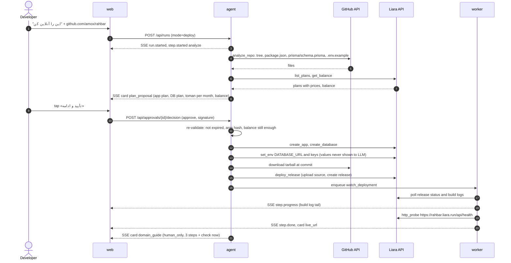
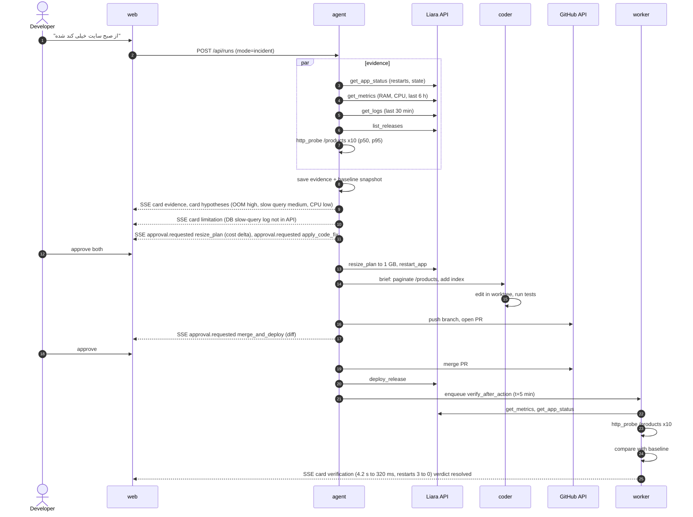

# System design

The "what and why" above the architecture. Read with `ARCHITECTURE.md` (how) and `DATA-MODEL.md`
(tables). Scope source: the Starcoach Liara brief. Agreed decisions: `decisions.md`.

Product: **«همکار فنی»** (Hamkar), a Persian DevOps/SRE colleague for a developer who has built an app
but knows nothing about deploying it. Persian RTL UI; English code and docs. Times stored in UTC,
shown in Jalali with Persian digits.

## 1. Problem

On Liara today the developer does every step alone: top up the balance, pick a plan, upload code or
connect GitHub, set env vars, wire a database, connect a domain at the registrar (IRNIC). When the
site later gets slow or returns 500, they read raw logs and graphs they don't understand and guess
between "restart", "bigger plan" and "my code".

Hamkar turns that into a conversation with cards: «این را آنلاین کن» + a GitHub link → a priced plan →
one approval → a live URL. «سایتم کند شده» → evidence, ranked causes, a proposed fix (including a code
fix by a coding agent), one approval → action → **re-measured proof that it worked**. It never spends
money, restarts, or deploys without a click, and it says plainly when Liara's API can't do something.

## 2. Users and jobs

| User | Job | Success |
|---|---|---|
| Developer, first deploy | "Put my Next.js + Prisma repo online; I know nothing about servers." | Live `*.liara.run` URL in < 10 min, one approval, no console visits except top-up |
| Developer, domain | "Connect `rahbar.ir`." | Domain added on Liara; 3 illustrated registrar steps; «الان بررسی کن» says when DNS is right |
| Developer, incident | "Since this morning the site is very slow." | Ranked causes with evidence in < 60 s; a fix applied after approval; before/after numbers |
| Developer, code-rooted bug | "/products is slow." | A PR with a readable diff, deployed on approval, latency verified |
| Developer, routine | "Tell me if something's off." | Scheduled checks (health, RAM trend, plan headroom) and a short digest; no paging |
| Team (2 students) | Verify Liara endpoints, write the incident eval set, test, document | Capability report (T-01), `make eval` green, md doc |
| Mohammad | Build and demo | `make dev`, `make check`, one reproducible demo script |

## 3. Requirements

### Functional (MVP)

1. Connect accounts: Liara API token (from console) and GitHub (App or fine-grained token: contents read, PR write).
2. Repo analysis: platform, runtime version, build/start commands, port, DB need, required env keys, RAM estimate. Deterministic detectors; the LLM only explains.
3. Plan proposal card: Liara app plan + DB plan with prices **from the Liara API**, monthly cost in toman, current balance, "nothing is spent until you approve".
4. First deploy pipeline: create app → create DB → set env (including `DATABASE_URL`) → deploy release → stream build logs → health check → live URL. A live checklist, one row per step.
5. Domain: add domain via API; registrar guide (human_only) with a «الان بررسی کن» DNS probe.
6. Incident (SRE) loop: symptom → evidence (logs, CPU/RAM, restarts, releases, HTTP probe) → ranked hypotheses with confidence → proposed actions → approval → act → **verify after action** → report.
7. Code fix: brief to a Claude Code subagent in a git worktree → branch + PR → diff card → approval → merge and deploy → verify.
8. Approval gate on every sensitive tool, enforced in code.
9. Explicit limitation messages wherever the API can't do something.
10. Recurring checks: scheduled health probe, RAM/CPU trend, plan headroom, a digest in the chat.
11. Incident timeline: evidence, hypotheses, actions and verification saved and viewable as a post-mortem.

### Non-functional

| Area | Target |
|---|---|
| Latency | First visible checklist row < 2 s after a message; evidence gathered < 30 s; first ranked hypotheses < 60 s |
| Truth | Every number on screen carries source (`liara.metrics`, `liara.logs`, `probe`, `github`) and a timestamp; no invented metrics |
| Safety | Zero sensitive actions without a consumed, unexpired, signed approval; verified by tests |
| Secrets | Liara/GitHub tokens encrypted at rest, never in LLM context, never in logs or SSE |
| Resilience | A worker/agent restart mid-deploy resumes from the `deployment` row; Liara 5xx/429 retried with backoff |
| Cost | No paid LLM API in the MVP (Claude subscription via Claude Code); Liara spend only on approval |
| UX | Persian-first, RTL, works at 360 px; short prose, status as checklist and cards |
| Ops | Runs on Mohammad's Mac via Docker Compose; no 24/7 monitoring stack |

### Scope and non-goals

In scope: one Liara account, one or a few apps per project, Node/Next.js and Python apps, Postgres DB,
GitHub repos, the Torob app («راهبر خرید») as the real demo target.

Out of scope (MVP): 24/7 monitoring or paging (Prometheus, Grafana, alertmanager); multi-user teams
and RBAC; non-GitHub hosts; paying or topping up on the user's behalf; registrar automation (IRNIC
has no public API); an "auto" mode for sensitive tools; other PaaS adapters; a hosted multi-tenant
Hamkar (needs the BoxAPI backend, later).

## 4. Agent modes and the run model

A user message starts a **run**: a sequence of **run steps** shown as a live checklist. Each step may
call tools; sensitive tools pause the run on an **approval**.

| Mode | Steps |
|---|---|
| `deploy` | analyze repo → propose plan → **approve** → create app → create DB → set env → deploy release → health check → domain guide |
| `incident` | read symptom → gather evidence → rank hypotheses → propose actions → **approve** → act → verify (before/after) → report |
| `chat` | answer a question with read tools only (status, logs, balance) |

The model picks tools; the mode fixes the shape of the checklist so the user always knows where they are.

## 5. Core flow 1 — first deploy

If the balance is below the first month's cost, step 3 becomes a `human_only` top-up card with a
link to the Liara console and a «موجودی را دوباره بررسی کن» button; the run waits in
`awaiting_user`, it doesn't fail.

## 6. Core flow 2 — incident and the SRE loop with verify-after-action

**Verify-after-action** is a separate step, not a sentence. Each `incident_action` declares its
success criteria when proposed (e.g. `restarts_1h == 0`, `p95_products_ms < 800`, `ram_peak < 85%`).
The `verify_after_action` job waits a settle time (default 5 min, 2 min in demo mode), samples the
same sources as the baseline, and writes a `verification` with verdict:

| Verdict | Rule | What the user sees |
|---|---|---|
| `resolved` | every criterion met | green card «مشکل رفع شد · بررسی‌شده» with before/after |
| `improved` | some met, none worse | amber note + the next hypothesis offered |
| `not_resolved` | none met | incident re-opens at the next-ranked hypothesis |
| `regressed` | a criterion is worse | red card + one-tap `rollback_release` (approval) |
| `inconclusive` | data missing (e.g. metrics unavailable) | grey card saying which data was missing; never claimed fixed |

## 7. Hypothesis ranking

Deterministic signals first, then the model writes the explanation and may re-order with a reason.

| Signal (source) | Points to |
|---|---|
| `heap out of memory`, OOMKilled, restarts ≥ 2/h (logs, status) | RAM shortage / leak |
| RAM ≥ 90% of plan for ≥ 10 min (metrics) | under-sized plan |
| CPU at plan ceiling with throttling (metrics) | CPU limit |
| Slow endpoint in probe + slow SQL lines in app logs | slow query (code) |
| Errors start at a release timestamp (releases, logs) | bad release → rollback |
| 5xx with stack traces in app code (logs) | application bug (code) |
| Probe fails, app `stopped`/`crashed` (status) | app down |

Each hypothesis stores confidence (`high/medium/low` + a 0–1 score), the evidence ids it rests on,
and the proposed actions. The UI never shows a hypothesis without its evidence.

## 8. Risk model

| Class | Behaviour | Tools |
|---|---|---|
| `read` | runs automatically; shown as a checklist row | `analyze_repo`, `list_plans`, `get_balance`, `get_app_status`, `get_logs`, `get_metrics`, `list_releases`, `get_env_keys` (names only), `check_dns`, `http_probe` |
| `sensitive` | needs an approval card; executes only after a valid decision | `create_app`, `create_database`, `set_env`, `deploy_release`, `restart_app`, `resize_plan`, `rollback_release`, `add_domain`, `apply_code_fix`, `merge_and_deploy` |
| `human_only` | agent writes step-by-step instructions + a «الان بررسی کن» probe; never pretends to do it | `top_up_balance`, `registrar_dns_records` |

The risk class lives in the tool registry (code), not in the prompt. A tool with no class fails to
register.

## 9. Approval gate

The card answers four questions: **what** (tool + plain-Persian summary), **why** (the hypothesis or
plan it serves), **cost** (delta in toman per month, from Liara plan prices, with source and time),
**what changes** (env key names, plan before → after, release id, or the code diff).

Rules:

1. Created by the SDK permission callback `can_use_tool` for any tool whose class is `sensitive`; the run pauses.
2. One decision per approval, bound to `(approval_id, tool_name, args_hash, user_id, expires_at)` and signed with HMAC-SHA256 (server key). Approve and reject both consume it.
3. Expires 10 minutes after creation. An expired approval is denied with a reason the model receives and the user sees.
4. **Re-validated just before execution**: signature, not consumed, not expired, args hash unchanged, and fresh state checks (balance still covers cost, app still on the plan the card showed, PR head still the reviewed commit).
5. The tool implementation checks again that a consumed `approved` approval exists for this `tool_call` (defence in depth, in case the callback is bypassed).
6. Grouped approval («تأیید ۱ و ۲») creates one approval per action; the UI submits them together.
7. Every decision is written to `audit_log` with who, when, what, args hash and outcome.

## 10. Liara API capability matrix

Base `https://api.iran.liara.ir`, `Authorization: Bearer <token>`. **Every endpoint below is to verify
in T-01**; the capability report fixes the final paths and fields.

| Capability | Expected endpoint (to verify) | Tool | Risk | If missing / limited |
|---|---|---|---|---|
| Account, balance | `GET /v1/me` | `get_balance` | read | limitation: "balance not readable; check the console" |
| Plans + prices | `GET /v1/plans` (or embedded in `/v1/me`) | `list_plans` | read | fall back to a dated static table, labelled «قیمت از جدول ثابت، تاریخ …» |
| Create app | `POST /v1/projects` `{name, planID, platform}` | `create_app` | sensitive | — (core) |
| Create DB | `POST /v1/databases` `{type, planID, hostname, version}` | `create_database` | sensitive | if connection info not returned: instructions to copy it from console (human_only) |
| Env vars | `POST /v1/projects/update-envs` | `set_env` | sensitive | — |
| Read env names | `GET /v1/projects/{name}` | `get_env_keys` | read | values are never read or shown |
| Upload source | `POST /v2/projects/{name}/sources` | `deploy_release` | sensitive | — |
| Create release | `POST /v2/projects/{name}/releases` | `deploy_release` | sensitive | — |
| Releases, build logs | `GET /v2/projects/{name}/releases[/{id}]` | `list_releases` | read | — |
| Rollback | `POST /v2/projects/{name}/releases/{id}/rollback` | `rollback_release` | sensitive | redeploy previous source if no rollback endpoint |
| Runtime logs | `GET /v2/projects/{name}/logs?since=` | `get_logs` | read | — |
| CPU/RAM/network | `GET /v1/projects/{name}/metrics/...` | `get_metrics` | read | limitation; incident relies on logs + probe, verdicts become `inconclusive` where needed |
| Status, restarts | `GET /v1/projects/{name}` | `get_app_status` | read | — |
| Restart | `POST /v1/projects/{name}/actions/restart` | `restart_app` | sensitive | scale 0 → 1 if only scale exists |
| Resize plan | `POST /v1/projects/{name}/resize` `{planID}` | `resize_plan` | sensitive | — |
| Add domain | `POST /v1/domains` `{name, project}` | `add_domain` | sensitive | — |
| Domain check | `GET /v1/domains/{id}/check` | `check_dns` | read | own DNS resolver lookup |
| DB slow-query log | none expected | — | — | **limitation**: «لاگ کوئری دیتابیس از API لیارا در دسترس نیست؛ کوئری کند را از لاگ خود اپ پیدا کردم» |
| HTTP latency | none expected | `http_probe` | read | our own probe; source labelled `probe` |
| Top-up | none | `top_up_balance` | human_only | instructions + console link + re-check |
| Registrar DNS | none (IRNIC) | `registrar_dns_records` | human_only | 3-step guide + `check_dns` |

**Limitation handling.** A tool that can't do its job returns `{"status":"limitation","code":…,"message_fa":…,"workaround":…}`
instead of raising. The agent must relay it; the UI renders a grey limitation box; a
`limitation_event` row records it (and feeds the md doc's "limits" section). Unknown 404/405 from an
endpoint marked "to verify" is mapped to a limitation, not a crash.

## 11. Security model

- **Tokens at rest**: Liara and GitHub tokens in `liara_connection` / `github_connection` encrypted with AES-GCM (key `HAMKAR_SECRET_KEY` in env, key id stored with the ciphertext for rotation). Only the last 4 characters are shown.
- **Never in LLM context**: tools take `project_id`; the token is resolved server-side inside the tool. Tool outputs pass a redactor (token patterns, `postgres://user:pass@`, `*_SECRET`, `*_KEY` values) before reaching the model or SSE. `get_env_keys` returns names only; `create_database` returns "DATABASE_URL set (value hidden)".
- **Never logged**: structured logger with a deny-list of fields and the same redactor; HTTP client logs method, path and status only; tests assert a fake token never appears in logs, SSE frames or `tool_call` rows.
- **Agent sandbox**: the main agent may use only `mcp__hamkar__*` tools; Claude Code built-ins (Bash, Read, Write, WebFetch) are disallowed; no user/project settings or CLAUDE.md are loaded.
- **Coder sandbox**: Read/Edit/Bash limited to the worktree `~/.hamkar/work/<project>/`; Bash allow-list (package manager test/build, `git diff`, `git status`); no network push from the subagent. Our code commits, pushes and opens the PR with the GitHub token the subagent never sees.
- **Prompt injection**: logs, repo files and README text are wrapped as data (`<untrusted source="liara.logs">…</untrusted>`); a sensitive action requested by such text still needs the user's approval, and the card says where the idea came from.
- **Web auth**: single-user MVP with a session cookie (httpOnly, SameSite=Lax) from a local login; approval decisions also require the per-approval signature from the SSE event.
- **Audit**: every tool call (args hash, risk, result status, duration) and every decision in `tool_call` / `audit_log`.

## 12. Failure modes and how they are surfaced

| Failure | Detection | What the user sees |
|---|---|---|
| Liara token invalid/expired (401) | client error mapping | card «توکن لیارا منقضی شده» + reconnect; run paused, not failed |
| Liara 429/5xx | client | retried 3× with backoff; then step `failed` with the status and «دوباره تلاش کن» |
| Endpoint missing (404/405 on "to verify") | client | limitation box with workaround |
| Insufficient balance | `get_balance` vs plan price | human_only top-up card, re-check button; run `awaiting_user` |
| Build fails | release status `failed` | build log tail (redacted) + hypotheses (missing env, wrong Node version, build script) |
| App crashes after deploy | health probe fails 3× | step failed + switch to incident mode with evidence already gathered |
| DNS not propagated | `check_dns` mismatch | «هنوز نه»: what's expected vs seen; scheduled re-check in 15 min |
| Approval expired / rejected | gate | card greys out with reason; agent continues with read-only advice |
| State changed before execution | re-validation | «وضعیت عوض شده»: new card with fresh numbers |
| Claude Code not logged in / usage limit | SDK error | banner «دستیار موقتاً در دسترس نیست»; read-only status page still works |
| Coder can't produce a passing fix | tests fail in worktree | no PR; card with what was tried and the failing test |
| GitHub permission missing | 403 | card naming the missing permission (contents read / pull requests write) |
| Metrics unavailable | limitation | evidence card without metrics; verdicts at most `improved` or `inconclusive` |
| Agent/worker restart mid-run | run/deployment rows | run resumes from last completed step; deployment watcher re-attaches to the release id |
| Redis down | health check | SSE falls back to polling `GET /api/runs/{id}`; approvals still work via Postgres |

## 13. Recurring checks (no 24/7 monitoring)

`scheduled_check` rows, run by the worker (arq cron): health probe every 15 min, RAM/CPU trend every
hour, plan headroom daily, domain/TLS daily. A `check_result` that crosses a threshold posts one
message in the project's conversation («RAM این هفته ۹۰٪ بوده؛ پیشنهاد…») and can open an incident on
the user's tap. Nothing pages anyone, and no sensitive action runs from a schedule.

## 14. Demo scenario script (~5 min)

Target: the Torob app «راهبر خرید» (Next.js + Prisma + Postgres) on a real Liara account (~2M toman).

| Time | Beat | Shows (criterion) |
|---|---|---|
| 0:00 | Problem in one line; Liara's 5 manual steps vs one sentence | context |
| 0:20 | «این را آنلاین کن» + repo link; analysis card (Next.js 16, Node 22, Postgres from `prisma/schema.prisma`, env keys, ~512 MB) | intelligence, integration |
| 0:50 | Plan card with real prices + balance; tap approve | UX, approval |
| 1:10 | Live checklist: app, DB, env, build logs streaming, health check, `rahbar.liara.run` opens | integration |
| 1:50 | «دامنه rahbar.ir را وصل کن» → `add_domain` approval → registrar guide (human_only) → «الان بررسی کن» says "not yet" honestly | UX, limits |
| 2:20 | Break it: fault switch turns on a memory leak (OOM restarts) and a slow unpaginated `/products` query | — |
| 2:40 | «از صبح سایت خیلی کند شده» → evidence (heap OOM, 3 restarts/h, `/products` 4.2 s, slow SQL in app logs) + limitation box (DB query log not in API) | intelligence, limits |
| 3:10 | Ranked causes; two proposals: resize to 1 GB (cost delta) and code fix; approve both | intelligence, approval |
| 3:40 | Coder opens a PR (pagination + index); diff card; approve merge-and-deploy | intelligence (coding agent) |
| 4:20 | Verification card: `/products` 4.2 s → 320 ms, restarts 3 → 0, RAM peak 97% → 61%, each with source + time; verdict resolved | intelligence (verify) |
| 4:40 | Incident timeline / post-mortem, recurring checks list, audit log | reliability, security |

Fault injection lives in the Torob app behind env flags (`FAULT_LEAK_MB_PER_MIN`, `FAULT_PRODUCTS_NO_LIMIT`),
set through `set_env` with approval, so the failures are real and repeatable.

## 15. Mapping to the 300-point rubric

| Criterion | Points | Where we earn it |
|---|---|---|
| Liara integration | 100 | 16 Liara-backed tools; full first deploy on a real account (app, DB, env, release, logs, domain); resize/restart/rollback; capability report T-01 |
| Intelligence | 100 | repo analysis; log + metric evidence; ranked hypotheses with confidence and evidence; code fix by a coding agent with PR; verify-after-action with five verdicts; SRE eval set with expected top cause |
| UX | 50 | one sentence to start; live checklist; cards (plan, evidence, hypotheses, diff, verification); approval cards with cost in toman; Persian-first RTL; honest human_only guides |
| Reliability & security | 50 | approval gate in code with signed one-time decisions and re-validation; tokens encrypted and kept out of the LLM; limitation boxes; recurring checks; resumable runs; audit log |

## 16. Milestones

| Phase | Gate |
|---|---|
| P0 Foundation | Compose + Makefile + CI; T-01 Liara capability report; agent SDK + `hamkar` MCP server hello-world; schema v1; brand tokens |
| P1 First deploy | Torob app live on Liara through Hamkar with one approval; domain guide |
| P2 SRE loop | OOM + slow query found, fixed (resize/restart) and verified; limitation boxes; incident timeline |
| P3 Coding fix + recurring checks | Coder PR → diff → merge-and-deploy → verified; scheduled checks and digest |
| P4 Ship | md doc (architecture, Liara API usage, limits, interaction); eval run; ~5 min demo video |
